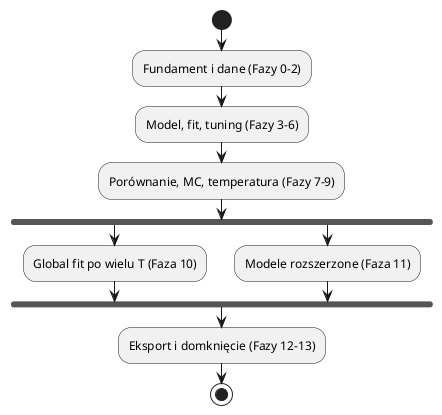

# JFM — Roadmap implementacji

**Status:** plan faz implementacji, na bazie `JFM_functional_specification.md` i `jfm-scientific-research-perplexity.md`.
**Zasada:** Core gotowy (~99%) — JFM to czysty moduł domenowy budowany na nim, bez node editora i systemu pluginów.
**Podejście:** implementacja wzdłuż pipeline'u analizy — każda faza kończy się wynikiem widocznym na wykresie, zanim przechodzimy dalej.
**Data:** 2026-07-05.

---

## Decyzje zakresu (przyjęte)

1. **Global fit po wielu temperaturach wchodzi do zakresu JFM** (nie JFM+). §13.5 spec. funkcjonalnej i §8 dokumentu naukowego sugerują odłożenie do JFM+, ale przyjęto wersję z §2 (pełny zakres, z globalnym fitem). Wymaga nowego obiektu domenowego, którego żaden z dokumentów źródłowych nie nazywa wprost — patrz Faza 10.
2. **Katalog modeli podstawowych budowany naraz.** `SD-0`, `SD-Rs`, `SD-Rsh`, `SD-RsRsh`, `SD-Iph` trafiają do jednej fazy (Faza 3), bo i tak wymagają tej samej infrastruktury solvera implicit (Lambert W, Newton/Halley).
3. **GPU równolegle z CPU od początku, przy każdym etapie z realnym solverem/optymalizacją**: katalog modeli (3), fit pojedynczy (4), fit wielu/serii (6), Monte Carlo (8), global fit (10), modele rozszerzone (11). UI, eksport i tuning nie dostają osobnej pracy GPU — korzystają z gotowych kerneli z wcześniejszych faz.

## Mapa faz

```
Fundament i dane (Fazy 0-2)
  -> Model, fit, tuning (Fazy 3-6)
  -> Porównanie, MC, temperatura (Fazy 7-9)
  -> równolegle (dowolna kolejność):
       - Global fit po wielu T (Faza 10)
       - Modele rozszerzone (Faza 11)
  -> Eksport i domknięcie (Fazy 12-13)
```

Wersja do wklejenia w docs MkDocs (PlantUML):



---

## Faza 0 — Fundament domenowy JFM na Core

**Walidacja wizualna:** pusty projekt i drzewo widoczne w UI.

- Klasy domenowe: `Project`, `Series`, `Characteristic`, `FitRun`, `MonteCarloRun`, `DerivedAnalysis` (§3) — na razie jako struktury danych
- Osadzenie modułu JFM w istniejącym systemie okien/paneli Core
- Pusty widok drzewa projektu: projekt → seria → charakterystyka (§15.1)
- Nowy projekt / nowa seria (puste)

## Faza 1 — Import + kontrola jakości + wizualizacja surowych danych

**Walidacja wizualna:** zaimportowana rodzina charakterystyk na wykresie, kolorowana wg `T`.

- Parsery `.dat` / `.txt` / `.csv` / `.tsv` + rozpoznawanie/ręczne mapowanie kolumn `V`/`I`/`J`/`T`/metadane (§4.1–4.2)
- Odczyt temperatury: nazwa pliku, nagłówek, kolumna, edycja ręczna (§4.3)
- Import pojedynczy/wielokrotny/katalogu, przypisanie do serii, auto-sort po `T` (§4.4)
- Rejestracja zewnętrznych skryptów importu (Python, hot-reload, dynamiczna rejestracja) na bazie istniejącego osadzenia Pythona (§4.1)
- QC: braki kolumn, jednostki (domyślne gdy brak), brak `T`, duplikaty, niemonotoniczność `V`, puste/nienumeryczne punkty, saturacja/compliance, wiele sweepów + rozdzielanie (§4.5)
- Panel statusu importu w UI, nie konsola (§18.1)
- Wykres surowych danych: liniowy / semi-log / signed-log (§14.1–14.2)
- Minimalny eksport `.tsv` danych surowych — wczesna weryfikacja w OriginPro

## Faza 2 — Preprocessing + zakres dopasowania

**Walidacja wizualna:** raw/processed/ranged rozróżnialne na wykresie, granice zakresu przeciągane myszką.

- Konwersja jednostek, `I`↔`J` (przy znanej powierzchni), korekta znaku jako jawna akcja (§5.1)
- Duplikaty, oznaczanie punktów wyłączonych z fitu, log operacji widoczny w historii (§5.1)
- Zakres manualny: panel + uchwyty na wykresie + skróty klawiszowe (§6.2)
- Zakres automatyczny: zły znak `I`, dominacja `-I_0`/offsetu przy niskim `V`, wejście w `R_s`, rolloff/kink (§6.1, §7.1–7.2 dok. nauk.)
- Zakres jako atrybut przyszłego `FitRun` (§6.3)
- Status zewnętrznych skryptów preprocessingu/walidacji: użyty/nieużyty/błąd (§5.2)

## Faza 3 — Katalog modeli podstawowych + solver CPU/GPU + prefit

**Walidacja wizualna:** krzywa prefit nałożona na dane, dla każdego z 5 modeli.

- Modele: `SD-0`, `SD-Rsh` (jawne `I(V)`); `SD-Rs`, `SD-RsRsh`, `SD-Iph` (implicit) (§7.1 spec., §1.2 dok. nauk.)
- Solver implicit: Lambert W + fallback Newton-Raphson/Halley, zabezpieczenia overflow/underflow (§2.2 dok. nauk.)
- Ta sama logika w wersji CPU i równoległej GPU (batch po `V` / po zestawach parametrów) + test zgodności CPU↔GPU na wspólnych wektorach (§18.3 dok. nauk. jako wzorzec rygoru)
- Parametry: estimated/initial/fitted/tuned, jednostka, fixed/free, bounds (w tym „brak granicy” i wykrywanie `min ≥ max`), skala log dla `I_0`/`R_s`/`R_sh` — identycznie CPU i GPU (§8)
- Prefit dla wszystkich 5 modeli: initial guess, bounds, sugerowany zakres, parametry do tymczasowego zafiksowania, ostrzeżenia o identyfikowalności; jawny status „prefit niedostępny” gdy brak (§5.3)
- Identyfikacja modelu przez składniki fizyczne w UI/eksporcie, mapowanie legacy `4P`/`6P` (§7)

## Faza 4 — Fit pojedynczej charakterystyki (CPU/GPU) + ocena wyniku

**Walidacja wizualna:** dopasowana krzywa + `chi²`/residua na ekranie.

- Solver fitu (Simplex — kontynuacja istniejącej funkcjonalności) w wersji CPU i GPU + test zgodności (§9.1, §19 pkt 7)
- Obiekt `FitRun`: model, zakres, initial values, fixed/free, bounds, wynik, błędy, status (§3.4)
- Raport: status (sukces/fail/przerwany/podejrzany/na granicy), reduced `chi²`, `Δchi²`, iteracje/ewaluacje, flagi granic/niefizyczności, residua, krzywa, config (§9.2)
- Trace Simplexa dla pojedynczego przebiegu debugowego (§9.3) — bez rozszerzania na MC
- Start od „fit aktywnej charakterystyki”; „zaznaczone/seria” startują tu, dojrzewają w Fazie 6
- Warstwy na wykresie: raw/ranged/fitted (+ tuned jako placeholder), residua jako osobny panel (§14.1, §14.3)

## Faza 5 — Tuning ręczny

**Walidacja wizualna:** suwak parametru natychmiast zmienia krzywą tuned.

- Równoległe widoki estimated/fitted/tuned (§11.1)
- Live preview krzywej tuned, niezależnej od fitted (§11.2)
- Przeniesienie tuningu: tuned→initial, tuned→fixed, przepisanie do configu kolejnego fitu, undo, reset tuned→fitted (§11.3)
- Tryb auto-fit po zmianie tuningu, jawnie włączany (§11.4)

## Faza 6 — Fit wielu charakterystyk/serii + zarządzanie UI

**Walidacja wizualna:** zaznaczenie całej serii + jeden klik → wszystko dopasowane, statusy w drzewie.

- Multi-select: pojedyncze, Ctrl, Shift, drag, cała seria, odwrócenie (§15.2)
- Context menu: hide/unhide, select/invert, change model, set dark/light, fit selected, run MC selected, color preset, remove, export selected (§15.3)
- Statusy w drzewie: zaimportowane, wymaga prefit, fitted, fit failed, MC available, warning, excluded, model candidate, result outdated (§15.4)
- Fit wielu modeli kandydackich naraz dla tej samej charakterystyki (przygotowanie pod Fazę 7)
- Naturalne miejsce na realny zysk z GPU batch (wiele charakterystyk naraz) — warto zmierzyć różnicę względem CPU

## Faza 7 — Porównanie modeli (podstawowych)

**Walidacja wizualna:** tabela zestawiająca 5 modeli z rekomendacją.

- Uruchomienie kilku modeli kandydackich, zestawienie parametrów / reduced `chi²` / `Δchi²` / liczby parametrów / flag niefizyczności / residuów (§10)
- AICc/BIC (§14.1 dok. nauk.), filtr fizyczności (§14.2), ranking z modelami „prawie równoważnymi” przy `ΔAIC < 2` (§14.3)
- Rekomendacja jako sugestia, nie decyzja ostateczna — użytkownik nadpisuje (§10)

## Faza 8 — Monte Carlo (CPU/GPU) i niepewności

**Walidacja wizualna:** chmura punktów/rozkład parametrów po serii MC.

- Uruchamianie: aktywna/zaznaczone/cała seria; wiele niezależnych MC runów per `FitRun`; inny seed; porównanie runów (§12.1)
- Konfiguracja: liczba iteracji, model i poziom szumu, seed (w ustawieniach numerycznych), liczba zapisywanych próbek, presety (§12.2)
- MC batch na GPU (tysiące refitów równolegle) + CPU, test zgodności statystyk przy tym samym seedzie/konfiguracji
- Wyniki: rozkłady, scatter dla par parametrów, elipsoidy kowariancji, poziomy `Δchi²`, korelacje, statystyki centralne, percentyle, nieudane przebiegi + odsetek, parametry na granicach (§12.3)
- Niepewności empiryczne z MC jako główne źródło (§12.4); macierz kowariancji z fitu jako szybki dodatek

## Faza 9 — Analiza temperaturowa per-T i Arrhenius

**Walidacja wizualna:** `A(T)`, `I_0(T)` i wykres Arrheniusa z dopasowaną prostą i `E_a`.

- Wykresy parametrów vs `T`: `I_0`/`J_0`, `ln(I_0)`, `A`, `R_s`, `R_sh`, `alpha`, `R_sh2` (jeśli dotyczy), parametry light (§13.1)
- Wybór osi: `T`, `1/T`, `1000/T`, `1/(kT)`, plus `1/(A·kT)` dla wykresów ideality-zależnych (§13.2)
- Arrhenius: `ln(I_0)` vs `1000/T` i vs `1/(kT)`, `A·ln(I_0)` vs `1/(kT)`, dopasowanie liniowe → nachylenie/przecięcie/`E_a` z poprawną konwersją zależną od osi (§13.3, tabela §6.5 dok. nauk. — krytyczne, żeby nie pomylić konwencji)
- Wiele serii, wiele dopasowań na serię, porównania serii (§13.4)
- Propagacja niepewności (`ln I_0`, `A·ln I_0`, `E_a` z nachylenia) z pełną kowariancją `A`–`I_0` (§11.2 dok. nauk.), zasilana danymi z MC (Faza 8)

## Faza 10 — Global fit fizyczny po wielu temperaturach

*(równolegle z Fazą 11)*

**Walidacja wizualna:** jeden fit obejmujący całą rodzinę `T`, z parametrami wspólnymi zaznaczonymi w UI.

- Krótki design pass przed kodem: żaden dokument nie nazywa tego obiektu — zdefiniować odpowiednik `FitRun` na wielu `Characteristic` + model + podział parametrów wspólne/per-T; warto spisać jako mini-ADR, zgodnie z konwencją projektu
- UI do oznaczania parametrów jako global (np. stałe `A`, albo `E_a` jako bezpośrednio fitowany) vs per-T wolne
- Wspólna funkcja celu: stackowanie residuów po wszystkich włączonych `T`, jedna minimalizacja `chi²`
- CPU + GPU równolegle (prawdopodobnie najcięższy numerycznie etap w całym JFM), test zgodności
- Porównanie ze Strategią A (Faza 9) — czy narzucenie wspólnych parametrów istotnie pogarsza dopasowanie
- Raport: globalne `E_a` i parametry wspólne + niepewności, parametry per-T + niepewności, wspólne `chi²`/dof
- Nadal poza zakresem (bez zmian): pełna automatyczna interpretacja mechanizmu Raua, analiza odwrotna (§13.5)

## Faza 11 — Katalog modeli rozszerzonych

*(równolegle z Fazą 10)*

**Walidacja wizualna:** `TE-IR`/`TE-SCR` dają sensowne `A'(T)`/`1/A(T)` na realnych danych heterozłącza.

- `2D-RsRsh`/`2D-Iph` (Lambert W częściowo + Newton), `TE-IR` (`A'(T)`), `TE-SCR` (`1/A(T)`), `BTD` (rozwiązanie dwuetapowe), `SD-PLsh` (potęgowy bocznik), `SCLC` (diagnostyczny, log-log)
- CPU + GPU dla każdego, ta sama zasada parzystości co w Fazie 3
- Jawny status per model: routine/eksperymentalny/diagnostyczny/wymaga ręcznej interpretacji, widoczny w UI i eksporcie (§7.3)
- Wykresy diagnostyczne: `A(T)·T` i `1/A(T)` (rozszerzenie Fazy 9), log-log `J-V` dla `SCLC`, widok roll-over/cross-over dla `BTD`
- Zastrzeżenie w UI: wynik modelu rozszerzonego nie jest automatycznym dowodem mechanizmu fizycznego (§7.3)
- Pełny zestaw modeli barierowych/wielobarierowych pomijamy — dokument sam oznacza to „do przedyskutowania”

## Faza 12 — Eksport pełny + persystencja projektu

**Walidacja wizualna:** komplet `.tsv` gotowy do OriginPro, projekt zapisuje się i wczytuje.

- Parametry (`.tsv`): seria, charakterystyka, `T`, dark/light, model, zakres, fitted, niepewności, reduced `chi²`, `Δchi²`, status, flagi (§17.1)
- Krzywe: raw, ranged, fitted, tuned, residua, wartości per model kandydacki (§17.2)
- MC: surowe wyniki, parametry iteracji, `Δchi²`, status iteracji, percentyle, macierz kowariancji/dane do jej odtworzenia, scatter — jeden MC run = jeden jednoznaczny zestaw plików (§17.3)
- Arrhenius/pochodne: punkty, przeliczone osie, dopasowania liniowe, nachylenia, przecięcia, `E_a`, niepewności, opis zakresu `T` (§17.4)
- Brak zależności od Pythona dla tej podstawowej ścieżki (§17.5)
- Proste zapisz/wczytaj stan projektu (§2) — formalne domknięcie tutaj; jeśli w trakcie prac zabraknie tego wcześniej (żeby nie tracić długich sesji fitowania), warto wyciągnąć okrojony autosave poza kolejnością

## Faza 13 — Domknięcie: przegląd błędów/ostrzeżeń + 17 warunków ukończenia

**Walidacja wizualna:** przejście checklisty §19 od góry do dołu bez wyjątków.

- Systematyczny przegląd całej aplikacji pod kątem §18: import/fit/MC — statusy i błędy widoczne w UI, nie w konsoli
- Domknięcie ewentualnych luk w parzystości CPU/GPU (§19 pkt 7)
- Formalne przejście listy 17 warunków z §19, punkt po punkcie
- Ostatnia weryfikacja granicy JFM/JFM+ — czy global fit (teraz w zakresie) jest dobrze ograniczony i nic z JFM+ się nie wkradło

---

## Źródła

- `JFM_functional_specification.md`
- `jfm-scientific-research-perplexity.md`
- `PROJECT_CONTEXT.md`

---

*Dokument roboczy projektu JFM. Wersja 1.0, 2026-07-05.*