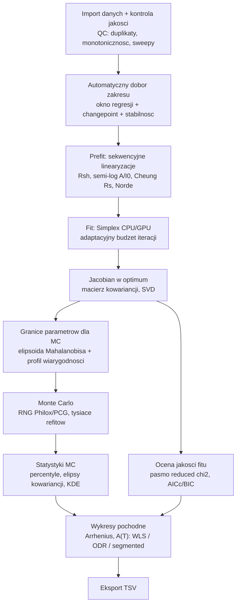

# JFM — specyfikacja algorytmiczna

**Status:** propozycja warstwy algorytmicznej uzupełniającej `JFM_functional_specification.md` i `jfm-scientific-research-perplexity.md`.
**Cel:** zebranie w jednym miejscu algorytmów numerycznych i statystycznych potrzebnych do zrealizowania zakresu JFM, uporządkowanych według zależności/ważności, jako materiał wejściowy przed projektowaniem API.
**Założenie:** dokument nie opisuje mechaniki Nelder-Mead Simplex ani simulated annealing (poza zakresem na wyraźną prośbę). Opisuje natomiast wszystko, co wokół tych optymalizatorów jest realnie potrzebne: funkcję celu i jej pochodne, kryteria zbieżności, adaptacyjne budżetowanie iteracji na GPU oraz warstwy przed i po samym fitowaniu.

---

## 1. Priorytetyzacja — od czego zależy wszystko inne

| Warstwa                            | Zakres                                                                                       | Sekcja     | Dlaczego ten priorytet                                                                                                                                              |
| ---------------------------------- | -------------------------------------------------------------------------------------------- | ---------- | ------------------------------------------------------------------------------------------------------------------------------------------------------------------- |
| **0 — fundament**                  | Wyznaczanie `I(V,T)`: modele jawne, Lambert W, Newton/Halley, BTD, zabezpieczenia numeryczne | §3         | Bez tego nic innego się nie uruchomi — prefit, fit, tuning, MC i eksport krzywych wołają dokładnie tę samą funkcję                                                  |
| **1 — pojedynczy wiarygodny fit**  | Prefit (linearyzacje), automatyczny dobór zakresu, Jacobian/kowariancja                      | §4, §5, §6 | Bez sensownych wartości startowych i zakresu optymalizator będzie rozbieżny albo trafi w wynik niefizyczny — szczególnie dla modeli zdegenerowanych (2D, TE-IR/SCR) |
| **2 — warstwa statystyczna/MC**    | Granice parametrów dla MC, adaptacyjny budżet iteracji GPU, progi reduced `chi^2`            | §7, §8, §9 | Potrzebne dopiero, gdy fit pojedynczej charakterystyki już działa; decydują, czy MC na tysiącach–milionach próbek jest wykonalne w rozsądnym czasie                 |
| **3 — analiza pochodna**           | Dopasowania na wykresach Arrheniusa i zależności T                                           | §10        | Nadbudowuje się na `FitRun` + `MonteCarloRun` z warstw 0–2; to tutaj powstaje właściwy wynik naukowy (`E_a`, `E_00` itd.)                                           |
| **4 — infrastruktura wspierająca** | RNG, szum, AICc/BIC, elipsy, percentyle, QC importu, KDE                                     | §11        | Dobrze poznane techniki inżynierskie — ważne dla jakości produktu, ale nie blokują rdzenia naukowego                                                                |

---

## 2. Mapa zależności między warstwami



Kluczowa obserwacja architektoniczna: **Jacobian w optimum (E) jest jednym węzłem współdzielonym** przez granice MC, ocenę jakości fitu i (pośrednio) diagnostykę identyfikowalności. Warto go liczyć raz i przechowywać jako część `FitRun`, a nie odtwarzać osobno w trzech miejscach.

---

## 3. Wyznaczanie prądu `I(V,T)` dla modeli z katalogu

To jest warstwa zerowa — każdy inny algorytm w tym dokumencie w końcu woła tę samą funkcję setki milionów razy (charakterystyki × punkty × iteracje Simplexa × próbki MC), więc jej poprawność i szybkość determinują wszystko.

### 3.1 Modele jawne (`SD-0`, `SD-Rsh`)

Bezpośrednia ewaluacja — jedyne ryzyko to overflow `exp()` dla dużych argumentów (patrz §3.7). Zero iteracji, więc to naturalny "tani" punkt odniesienia przy testach regresyjnych innych solverów.

### 3.2 Modele domknięte przez funkcję Lamberta W (`SD-Rs`, `SD-RsRsh`, `SD-Iph`)

Podstawienie prowadzące do postaci `z·e^z = x` jest już podane w dokumencie naukowym. Kluczowy jest **wybór solvera dla samej funkcji W**:

- Punkt startowy z aproksymacji zależnej od reżimu argumentu (asymptotyka dla małych i dużych `x`, seria wokół `-1/e` blisko gałęzi osobliwej) — nie startuje się od stałej wartości niezależnie od `x`.
- Dopolerowanie iteracją Halleya (rząd zbieżności 3), dokładnie ta klasa algorytmu co "Fritsch–Shafer–Crowley" wskazane w dokumencie naukowym: 2–4 kroki wystarczają do precyzji maszynowej z dobrego punktu startowego.
- To jest dokładnie to samo, co robi `scipy.special.lambertw` wewnętrznie — nie trzeba tego wynajdywać od zera, ale trzeba rozumieć, że "gotowa" implementacja Lamberta W nie rozwiązuje automatycznie problemu z §3.3 poniżej.

### 3.3 Log-space Lambert W — dlaczego jest konieczny

Argument funkcji W we wzorze na `SD-RsRsh`/`SD-Iph` zawiera **jawne `exp()`** wewnątrz. Przy niskim `T` lub dużym `R_s` wykładnik wewnątrz tego `exp()` łatwo przekracza ~709 (fp64) albo ~88 (fp32) — dokładnie przy tych argumentach, dla których cała reszta modelu jest jeszcze sensowna fizycznie. Naiwne policzenie `arg = C·exp(D)` i dopiero potem `W(arg)` overflowuje, zanim W w ogóle dostanie szansę zadziałać.

Rozwiązanie: dla dużego argumentu Lambert W ma znaną asymptotykę `W(x) ≈ ln(x) − ln(ln(x))` (z dalszymi poprawkami wyższego rzędu). Skoro potrzebujemy `ln(x)`, a nie `x`, można go policzyć **bez formowania `exp(D)` w ogóle**:

```
ln(arg) = ln(C) + D            # zamiast: arg = C * exp(D); ln(arg) = ln(arg)
W ≈ ln(arg) - ln(ln(arg)) + ln(ln(arg))/ln(arg) + ...   # z ln(arg) policzonego wprost
```

Praktyczna reguła: przełączać się na tę gałąź, gdy `D` przekracza jakiś próg bezpieczeństwa (np. 20–30) — asymptotyka jest już wtedy wystarczająco dokładna, a wciąż jesteśmy daleko przed overflowem. To jest dokładnie ten rodzaj detalu numerycznego, który odróżnia solver działający "w laboratorium na ładnych danych" od solvera działającego przy granicznych temperaturach i dużych `R_s`.

### 3.4 Modele bez postaci zamkniętej (`2D-RsRsh`, `2D-Iph`, `TE-IR`/`TE-SCR` z `R_s`, `SD-PLsh`)

Tu trzeba ogólnego rozwiązywacza `F(I) = 0`:

- **Newton–Raphson**: `I_{n+1} = I_n − F(I_n)/F'(I_n)`, z zabezpieczeniem (damping/bisekcja jako fallback, gdy krok wyprowadza poza sensowną domenę — funkcje wykładnicze potrafią mieć pochodną zmieniającą się o rzędy wielkości).
- **Metoda Halleya** (zbieżność rzędu 3, `I_{n+1} = I_n − 2FF'/(2F'^2 − FF'')`) — jak wskazano w dokumencie naukowym, preferowana gdy zależy nam na małej liczbie iteracji przy wysokiej dokładności; szczególnie opłacalna na GPU, bo mniej iteracji = mniej rozbieżności SIMT (patrz §8).
- Kryterium zbieżności: **mieszana tolerancja bezwzględna+względna** `|ΔI| < atol + rtol·|I|` (sama względna zawodzi w okolicy `I ≈ 0`, o czym mówi też dokument naukowy w kontekście signed-log).

**Ważna obserwacja upraszczająca:** `TE-IR` i `TE-SCR` w tabeli klasyfikacji dokumentu naukowego są oznaczone jako Lambert-W-rozwiązywalne — i słusznie. Dla *pojedynczej* temperatury `T` te modele mają dokładnie tę samą strukturę obwodową co `SD-0`/`SD-Rs`/`SD-RsRsh` (ten sam `J_00 exp(qV/A'kT)`), tylko z `A'` będącym efektywną idealnością zależną od `T`. Sens fizyczny `TE-IR`/`TE-SCR` (czyli konkretny kształt `A'(T)` czy `1/A(T)`) jest **ograniczeniem nakładanym na warstwę `DerivedAnalysis` między temperaturami**, a nie osobnym równaniem `I(V)` przy ustalonym `T`. Konsekwencja architektoniczna: solver `I(V,T)` dla `TE-IR`/`TE-SCR` może dosłownie wołać solver `SD-Rs`/`SD-RsRsh`, podając mu `A(T)` jako parametr wejściowy zamiast globalnej stałej. Nie trzeba pisać osobnego solvera implicit dla każdego modelu tunelowania — to jedna z niewielu realnych oszczędności implementacyjnych w tym katalogu.

Dla `2D-RsRsh` dobrym punktem startowym Newtona/Halleya jest rozwiązanie Lamberta W modelu `SD-RsRsh` z dominującą diodą (ignorując mniejszy prąd `I_02`) — traktowanie modelu bez zamkniętej postaci jako perturbacji modelu, który ją ma.

### 3.5 `BTD` — układ sprzężony

Dwie diody antyrównoległe z podziałem napięcia `V = V_m + V_b` to nie jedno równanie implicit, tylko **układ dwóch równań** (KCL: ten sam prąd przez obie diody; KVL: suma napięć równa `V`). Praktycznie: Newton 2D na `(I, V_m)` z jawnym Jacobianem 2×2, albo zagnieżdżony 1D root-find (bisekcja/Newton na proporcji podziału napięcia) wokół dwóch osobnych solverów diodowych z §3.2/3.4. Warto to potraktować jako strukturalnie odrębny przypadek, bo próba "spłaszczenia" go do jednego równania implicit zwykle kończy się źle uwarunkowanym Jacobianem blisko `V=0`.

### 3.6 Warm start / kontynuacja wzdłuż sweepu napięciowego

Rozwiązanie z poprzedniego punktu `V_{i-1}` jako punkt startowy dla `V_i`. To nie jest tylko optymalizacja szybkości — to zabezpiecza **ciągłość gałęzi** (niektóre modele mają więcej niż jedno matematyczne rozwiązanie, a chcemy fizycznie ciągłe). Ten sam mechanizm warto reużyć przy prefit (§4) i przy MC (§7) — każda replika MC startuje blisko rozwiązania nominalnego, więc ciepły start tam jest praktycznie darmowy.

### 3.7 Bezpieczeństwo numeryczne i wektoryzacja pod GPU

- Overflow: liniowa ekstrapolacja powyżej `x_max` (dokładnie tak, jak pokazano w pseudokodzie dokumentu naukowego), realizowana przez `select`/`where`, **nie przez branch** — rozgałęzienia zależne od danych zabijają przepustowość SIMT.
- Underflow: soft-clipping zgodnie z progami już przyjętymi w dokumencie naukowym (`exp(-600)` jako minimalna wartość).
- **Rekomendacja architektoniczna:** zaimplementować `I(V; params, T)` dla każdego modelu **dokładnie raz**, jako jedno źródło prawdy używane przez prefit, fit, live preview tuningu, MC i eksport krzywych. Rozjazd między "krzywą do podglądu" a "krzywą do fitu" to klasyczne źródło niespójności trudnych do zdiagnozowania.

---

## 4. Estymacja parametrów startowych (prefit): linearyzacje i dopasowania liniowe

Sedno prefit w tym katalogu modeli sprowadza się do jednej idei: **dla każdego parametru istnieje jakaś transformacja osi, w której model lokalnie linearyzuje się względem tego parametru**. Semi-log dla `A`/`I_0`, transformacja Cheunga dla `R_s`, nachylenie blisko `V=0` dla `R_sh`, funkcja Norde'a dla `φ_B`. Prefit to w istocie sekwencja "znajdź właściwą oś → policz na niej ważoną regresję liniową", nie jeden monolityczny krok.

### 4.1 Strategia sekwencyjna (kolejność ma znaczenie)

1. `R_sh` z regionu niskich napięć (§4.2)
2. `A`, `I_0` z regionu semi-log po odjęciu oszacowanego prądu bocznika (§4.3)
3. `R_s` metodą Cheunga z regionu wysokich napięć (§4.4)
4. Iteracyjne domknięcie (§4.7)

### 4.2 `R_sh` z regionu niskich napięć

Lokalna (ważona) regresja liniowa `I` względem `V` w oknie blisko `V=0` lub w reverse bias → `nachylenie⁻¹ = R_sh`. Dla małego okna i podatności na pojedyncze zaszumione punkty warto rozważyć **estymator Theila–Sena** (mediana nachyleń parami punktów) zamiast zwykłego OLS — odporniejszy przy małej liczbie punktów.

### 4.3 `A`, `I_0` z regionu semi-log (ważona regresja liniowa)

Po odjęciu `V/R_sh`: regresja `ln|I_diode|` względem `V` w regionie wykładniczym (z §5) → `nachylenie = q/(AkT)`, `przecięcie = ln I_0`. Wymaga **wag**, bo `y = ln I` ma `σ_y ≈ σ_I/I` — punkty przy małym prądzie dostają nieproporcjonalnie duży wpływ bez ważenia. Wagi `w_i = (I_i/σ_{I_i})²`, rozwiązanie w postaci zamkniętej sumami ważonymi (dokładnie te same wzory co przy dopasowaniu Arrheniusa w §10.1 — to jest ten sam algorytm zastosowany do innej osi).

### 4.4 `R_s` metodą Cheunga

`dV/d(ln I)` względem `I` → `nachylenie = R_s`, `przecięcie = AkT/q` (drugie, niezależne oszacowanie `A` — użyteczne jako cross-check zgodnie z uwagą w dokumencie naukowym). Wymaga numerycznej pochodnej z zaszumionych danych — patrz §4.6.

### 4.5 Funkcja Norde'a (dla modeli TE / Schottky)

Minimalizacja `F(V) = V/γ − (kT/q)·ln(I(V)/A_J)` po `V` (przeszukiwanie golden-section albo bisekcja na `dF/dV = 0`, `γ` dobrane większe niż spodziewane `A`). Minimum daje `φ_B`; przydatne, gdy standardowe metody zawodzą przy dużych prądach (dokładnie tak, jak opisuje dokument naukowy).

### 4.6 Różniczkowanie danych zaszumionych: filtr Savitzky'ego–Golaya

Metody Cheunga, Norde'a i differential resistance wymagają pochodnej z dyskretnych, zaszumionych punktów — surowe różnice skończone wzmacniają szum katastrofalnie. **Filtr Savitzky'ego–Golaya** (lokalne dopasowanie wielomianu niskiego rzędu w przesuwnym oknie metodą najmniejszych kwadratów, z analitycznym różniczkowaniem dopasowanego wielomianu) daje wygładzoną wartość *i* pochodną w jednym kroku (splot ze współczynnikami policzonymi raz, z góry). Uwaga: zbyt szerokie okno wygładza również prawdziwe cechy fizyczne (np. kink/S-kink) — to jest kompromis bias–wariancja, o którym dokument naukowy ostrzega przy okazji preprocessingu (§16.4).

### 4.7 Iteracyjne domykanie sekwencji

Ponieważ oszacowanie `R_sh` wpływa na region użyty do `A`/`I_0`, a `R_s` wpływa na górną granicę regionu semi-log — całość to naturalnie **iteracja punktu stałego**: 2–3 przebiegi całej sekwencji 4.2→4.4, za każdym razem z lepszym oszacowaniem pozostałych parametrów, zwykle wystarczające do zbieżności (bo sprzężenie w pierwszym przebiegu jest już przybliżone dobrze).

### 4.8 Propozycje `bounds`, `fixed` i ostrzeżenia o identyfikowalności

Regresja WLS daje nie tylko wartość, ale i błąd standardowy nachylenia/przecięcia — to naturalne źródło `bounds` (np. estymata ± `k`× błąd standardowy, albo rząd wielkości dla parametrów logarytmicznych). Prosty, tani sygnał "słabej identyfikowalności" wymaganej przez specyfikację funkcjonalną (§5.3): jeśli region wykładniczy użyty do regresji obejmuje mniej niż ~1 dekadę prądu, albo `R²` regresji jest poniżej progu — flaga ostrzegawcza, zanim jeszcze cokolwiek trafi do właściwego fitu.

### 4.9 Prefit wielotemperaturowy dla `TE-IR`/`TE-SCR`

Ponieważ (jak w §3.4) te modele przy pojedynczym `T` redukują się do zwykłego `SD-*`, ich prefit per-temperaturowy to po prostu 4.1–4.7 zastosowane osobno dla każdego `T`, dające *efektywne* `A(T_i)`. Właściwe parametry fizyczne (`E_00`, `α`, `Φ_f^b`, `E*`) nie są widoczne w żadnej pojedynczej charakterystyce — wychodzą dopiero z nieliniowego dopasowania kształtu `A(T)`/`1/A(T)` do zbioru tych efektywnych wartości w wielu temperaturach. To jest dokładnie mechanizm z §10.3 poniżej — te dwie sekcje się zazębiają i to jest zamierzone.

---

## 5. Automatyczny dobór zakresu dopasowania

### 5.1 Maskowanie fizyczne (twardy pierwszy filtr)

Zanim zacznie się jakakolwiek statystyka: odrzucenie `V`, dla których znak prądu jest niezgodny z modelem/trybem (dark/light, forward/reverse) — trywialne maskowanie, ale musi być pierwszym krokiem, bo żadna regresja nie naprawi punktów o złym znaku.

### 5.2 Ruchome okno regresji i wynik liniowości

Dla każdego kandydackiego okna o szerokości `w`: dopasowanie lokalnej prostej do `(V, ln|I|)`, policzenie `R²` (lub znormalizowanej wariancji residuów) jako funkcji pozycji `s(V)`. To samo okno daje "kandydacki `A(V)`" — jego płaskość jest sygnaturą prawdziwego regionu wykładniczego.

### 5.3 Detekcja punktów przegięcia (changepoint)

Zamiast sztywnego progu na `s(V)` (kruchego przy szumie), formalna detekcja punktów zmiany nachylenia. **PELT** (Pruned Exact Linear Time, Killick i in.) — programowanie dynamiczne z przycinaniem, znajdujące optymalne lokalizacje punktów zmiany w oczekiwanym czasie liniowym — jest naturalnym kandydatem: solidniejszy niż ręcznie dobrany próg, a wciąż tani obliczeniowo. Krzywizna (druga pochodna `ln|I|` po `V`, znowu z Savitzky'ego–Golaya) daje dodatkowy, komplementarny sygnał: silnie ujemna blisko `V=0` → dominacja `R_sh`; spłaszczenie przy dużych `V` → wejście w obszar `R_s`.

### 5.4 Analiza stabilności jako kryterium ostateczne

Dokument naukowy wprost proponuje: dopasowanie dla zakresu ±10–20% i porównanie wyników — jeśli `A` zmienia się o więcej niż 5%, zakres jest niestabilny. Formalizacja: to jest przeszukiwanie (grid albo naprzemienne przeszukiwanie współrzędnościowe: ustal jedną granicę, przeszukaj drugą, zamień) po kandydackich `(V_min, V_max)`, gdzie funkcja kosztu łączy "więcej punktów = mniejsza niepewność statystyczna" z "mniejszy dryf parametru przy perturbacji granic". Tanie, bo każdy wewnętrzny fit może startować z ciepłego punktu z poprzedniej iteracji (§3.6).

### 5.5 Detekcja kinku/S-kinku pod kątem `BTD`

Peak/inflection detection na wygładzonej różniczkowej rezystancji `R_diff(V) = dV/dI` (ta sama maszyneria Savitzky'ego–Golaya z §4.6) — lokalne minimum albo zmiana znaku `dR_diff/dV` sygnalizuje roll-over i sugeruje `BTD` jako model kandydacki, jednocześnie oznaczając region do ewentualnego wykluczenia z prostego fitu `SD`/`2D`.

---

## 6. Jacobian i macierz kowariancji — brakujące ogniwo

Simplex (świadomie pominięty w tym dokumencie) jest bezpochodny z definicji — to jego siła przy brzydkich, nieciągłych powierzchniach celu, ale nigdy nie produkuje Jacobianu. Tymczasem cała warstwa niepewności — macierz kowariancji `C ≈ σ²(JᵀWJ)⁻¹` wymagana explicite w dokumencie naukowym (§10.1), korelacje parametrów, condition number i wektory osobliwe potrzebne do diagnostyki identyfikowalności (§13.2) — wymaga dokładnie tego Jacobianu, policzonego **w punkcie optimum znalezionym przez Simplex**. To osobny krok post-fit, nie efekt uboczny optymalizacji.

**Jak liczyć J:**
- Różnice skończone (centralne, dokładniejsze niż w przód) — proste, zawsze działa, wrażliwe na dobór kroku `h` (za mały → szum odejmowania, za duży → obcięcie).
- **Różniczkowanie zespolone (complex-step)**: perturbacja parametru w płaszczyznę zespoloną (`θ + ih`), `Im(model(θ+ih))/h` jako pochodna — dokładność bliska precyzji maszynowej dla dowolnie małego `h`, bo nie ma odejmowania bliskich sobie liczb (znika druga strona klasycznego kompromisu różnic skończonych). Zastrzeżenie: wymaga, by cała ścieżka ewaluacji `I(V)` była "bezpieczna zespolenie" — `exp()` i Lambert W są, ale `abs()`, `min/max`, operacje typu `select` użyte w zabezpieczeniach z §3.7 psują analityczność. W praktyce: albo osobna "różniczkowalna" ścieżka ewaluacji bez tych operacji, albo różnice centralne jako bezpieczny fallback ogólny.

**Jak liczyć C ze stabilnością numeryczną:** liczenie `C` przez jawne odwrócenie `JᵀJ` podnosi liczbę uwarunkowania do kwadratu — lepiej liczyć przez **SVD** ważonego Jacobianu bezpośrednio. SVD daje przy okazji dokładnie to, czego dokument naukowy chce do diagnostyki identyfikowalności: wartości osobliwe (→ condition number `σ_max/σ_min`), i wektory osobliwe (→ kierunki w przestrzeni parametrów, które są słabo ograniczone przez dane — bogatsza diagnostyka niż sam skalarny condition number).

Ten krok jest bezpośrednim wejściem do §7 (granice MC) i do korelacji parametrów wymaganych przy porównaniu modeli (specyfikacja funkcjonalna §9.2, §10).

---

## 7. Efektywne wyznaczanie granic parametrów dla Monte Carlo

Chodzi o to, w jakim obszarze przestrzeni parametrów ma się poruszać (i być ograniczony) każdy z tysięcy–milionów pojedynczych re-fitów w ramach jednego `MonteCarloRun`. Za ciasno → obcięty, obciążony rozkład wynikowy. Za szeroko → każdy pojedynczy fit wolniej się zbiega i częściej trafia w lokalne minimum daleko od sensownego obszaru.

### 7.1 Naiwne podejście: niezależne pudełko `θ* ± n·σ`

Szybkie (jedna ewaluacja Jacobianu), ale zawodzi właśnie tam, gdzie ten katalog modeli jest najbardziej problematyczny: przy silnych korelacjach (`A`–`I_0`: `-0.95` do `-0.99` wg dokumentu naukowego). Pudełko zbudowane z niezależnych `σ` per parametr ignoruje tę korelację całkowicie.

### 7.2 Elipsoida Mahalanobisa zamiast pudełka

Region `{θ : (θ−θ*)ᵀC⁻¹(θ−θ*) ≤ κ}`, próbkowany przez rozkład Choleskiego `C = LLᵀ` (`θ = θ* + L·z`). To automatycznie respektuje korelacje. Konkretna skala problemu: pole elipsy przy korelacji `ρ` w stosunku do pola "naiwnego" prostokąta o tym samym zasięgu brzegowym (`±√κ·σ` na każdej osi) wynosi

$$
\frac{\text{Pole elipsy}}{\text{Pole prostokąta}} = \frac{\pi}{4}\sqrt{1-\rho^2}
$$

Dla `ρ = 0.95`: ok. **25%** — prostokąt marnuje ~75% swojej powierzchni na kombinacje parametrów niezgodne z danymi. Dla `ρ = 0.99`: ok. **11%** — marnotrawstwo rzędu ~89%. Efekt pogłębia się przy większej liczbie silnie skorelowanych parametrów (np. 7 parametrów `2D-Iph`), więc dla modeli wieloparametrowych elipsoida to nie kosmetyka, tylko realna różnica w tym, ile z budżetu obliczeniowego MC trafia w sensowny obszar.

### 7.3 Skala logarytmiczna

Powyższe (kowariancja, elipsoida, próbkowanie) powinno działać w przestrzeni `ln` dla `I_0`, `R_s`, `R_sh`, `R_sh2` i prefaktorów — zgodnie z wymogiem skali logarytmicznej ze specyfikacji funkcjonalnej (§8.4). Unika to bezsensownych ujemnych granic i lepiej odpowiada naturalnie multiplikatywnemu charakterowi niepewności tych parametrów.

### 7.4 Profil wiarygodności jako bardziej odporna alternatywa

Gdy przybliżenie kwadratowe jest podejrzane (parametr blisko granicy fizycznej, silnie asymetryczna wiarygodność): 1D skan profilu na parametr — bisekcja/golden-section szukająca, gdzie `Δχ²(θ_k)` przekracza próg (np. `Δχ² = 9` dla szerokiego, bezpiecznego pudełka przeszukiwania, w duchu twierdzenia Wilksa z §10.2 dokumentu naukowego). Droższe (każda ewaluacja = reoptymalizacja po pozostałych parametrach), ale liczone **raz na `FitRun`**, nie raz na próbkę MC — koszt jest więc łatwo zamortyzowany.

### 7.5 Partia pilotażowa — samokorygujące się granice

Mały pilotażowy batch (kilkaset replik) z granicami z 7.2–7.4; sprawdzenie odsetka fitów lądujących na/blisko granicy (reużywając księgowania "parametry na granicach", którego i tak wymaga specyfikacja funkcjonalna, §12.3); jeśli istotna część tam ląduje — geometryczne rozszerzenie tej granicy (np. ×2) i powtórzenie sprawdzenia. Prosty, samokorygujący się schemat, tani bo dotyka tylko małej próbki przed uruchomieniem właściwego, dużego MC.

### 7.6 Twarde granice fizyczne jako zewnętrzny bezpiecznik

Przecięcie wszystkiego powyższego z twardymi granicami fizycznymi (`A ∈ [0.5, 6]`, rezystancje/prądy > 0 itd., §14.2 dokumentu naukowego) — i **rozróżnienie znaczenia** trafienia w granicę statystyczną (miękką: po prostu rozszerz eksplorację) od trafienia w granicę fizyczną (twardą: potencjalna prawdziwa degeneracja, warto to pokazać użytkownikowi osobno — zgodnie z rozróżnieniem "na granicy" / "niefizyczny" ze specyfikacji funkcjonalnej, §9.2).

---

## 8. Adaptacyjny budżet iteracji Simplexa na GPU

### 8.1 Dlaczego stały budżet iteracji jest nieefektywny na GPU

SIMT wykonuje wątki w warpie w lockstepie. Fit z ciepłym startem (sąsiednia temperatura, replika MC blisko nominalnego wyniku) potrafi zbiec w kilkadziesiąt iteracji; fit źle uwarunkowany albo z zimnym startem — w kilkaset. Stały budżet dobrany na "najgorszy przypadek" marnuje ogromną część mocy obliczeniowej na fity, które dawno się zbiegły; budżet dobrany na przypadek typowy niedokańcza znaczącą część fitów.

### 8.2 Kryterium zbieżności per-instancja

Standard: rozrzut `chi²` między wierzchołkami simpleksu poniżej tolerancji, albo stagnacja najlepszego punktu przez ostatnie `k` iteracji. Ważne: to dokładnie te same wielkości, które i tak trzeba śledzić dla funkcji trace wymaganej przez specyfikację funkcjonalną (§9.3: najlepszy punkt, najgorszy punkt, sekwencja `chi²`) — kryterium zbieżności może reużywać tego księgowania praktycznie bez dodatkowego kosztu. Samo maskowanie już zbieżnych wątków (predykacja zamiast branch) pomaga trochę, ale **nie rozwiązuje** problemu lockstepu w ramach warpu — cały warp i tak czeka na najwolniejszy wątek w grupie.

### 8.3 Kompakcja strumienia — realne rozwiązanie problemu SIMT

Uruchamianie w stałych, małych paczkach iteracji (np. 32–64), po każdej paczce tania redukcja/scan flagujący status zbieżności, a następnie **kompakcja strumienia** (partycjonowanie oparte na prefix-sum, standardowy prymityw GPU) zbierająca podzbiór jeszcze niezbieżny do świeżej, gęstej, mniejszej tablicy przed kolejną paczką. W miarę postępu aktywna partia się kurczy i warpy pozostają w pełni zajęte wyłącznie realną, niedokończoną pracą — to jest mechanizm, który faktycznie dostarcza adaptacyjność na poziomie sprzętu, w odróżnieniu od samego flagowania per-wątek.

### 8.4 Predykcja budżetu z danych historycznych

Rozmiar *pierwszej* paczki iteracji można dobrać z ruchomej średniej / percentyla (np. p90) liczby iteracji z niedawno zakończonych podobnych fitów (ten sam model, sąsiednie `T`, albo — dla MC — z tego samego pilotażowego batcha co w §7.5, tylko wykorzystanego tu do innego celu: rozmiaru paczki, nie granic parametrów). Minimalizuje liczbę rund kompakcji potrzebnych do ukończenia większości fitów.

### 8.5 Schemat eskalacyjny (dwie fazy)

Faza 1: wszyscy dostają przewidziany budżet bazowy. Faza 2: tanio zidentyfikować (mam nadzieję: niewielki) niezbieżny ogon; dla *tego* podzbioru — eskalacja: albo większy budżet, albo (lepiej, bo brak zbieżności w hojnym budżecie zwykle oznacza faktyczne złe uwarunkowanie albo zdegenerowany start, nie "potrzeba więcej tego samego") restart z zaburzonym/wielokrotnym punktem startowym. Całkowity koszt ograniczony w przybliżeniu przez `N·budżet_bazowy + N_niezbieżne·budżet_eskalowany`, zwykle znacznie poniżej `N·budżet_najgorszego_przypadku`.

### 8.6 Grupowanie według modelu / liczby parametrów

Różna liczba wolnych parametrów między modelami (`SD-0`: 2, `2D-Iph`: 7) w jednym kernelu z mieszanymi rozmiarami simpleksu ponownie wprowadza niezbalansowanie obciążenia. Grupowanie fitów w jednorodne partie wg `(model, liczba aktywnych parametrów, wzorzec fixed/free)` przed uruchomieniem pozwala schematowi z §8.3 działać czysto na jednolitym kształcie pracy.

---

## 9. Poziomy „wystarczającego" reduced `chi²`

### 9.1 Rozkład i naturalny rozrzut

Jeśli model i model szumu są poprawne, `chi²` ma rozkład chi-kwadrat z `dof = N − k` stopniami swobody: `E[reduced chi²] = 1`, `Var[reduced chi²] = 2/dof`, więc `std = √(2/dof)`. To pokazuje, dlaczego nie ma jednej uniwersalnej liczby: przy `dof = 10` odchylenie standardowe wynosi ~0.45 (ogromny naturalny rozrzut — żądanie `reduced chi² ≈ 1` dokładnie jest nierealistyczne), przy `dof = 1000` to ~0.045 (pasmo `1 ± 0.1` jest już sensowne i wąskie).

### 9.2 Pasmo akceptacji z kwantyli rozkładu chi-kwadrat

Zamiast jednej liczby: pasmo `[chi2_ppf(α/2, dof)/dof, chi2_ppf(1−α/2, dof)/dof]` z odwrotnego dystrybuanty chi-kwadrat, warunkowane na `dof`. Warto rozróżnić kierunki: nienaturalnie **niski** reduced `chi²` zwykle sygnalizuje przeszacowane słupki błędu (problem kalibracji, patrz 9.3), a nienaturalnie **wysoki** — rzeczywisty brak dopasowania albo zły model szumu; te dwa przypadki powinny wywoływać różne działania, nie jedną wspólną flagę.

Szybkie, GPU-przyjazne przybliżenie zamiast pełnego solvera niekompletnej funkcji gamma: **transformacja Wilsona–Hilferty'ego** (1931), oparta na tym, że `(X/dof)^{1/3}` dla `X ~ chi²_dof` jest w przybliżeniu normalne:

$$
\frac{\chi^2_p}{dof} \approx \left(1 - \frac{2}{9\,dof} + z_p\sqrt{\frac{2}{9\,dof}}\right)^{3}
$$

gdzie `z_p` to kwantyl standardowego rozkładu normalnego. Dokładne nawet przy umiarkowanym `dof`, tanie do policzenia w gorącej ścieżce GPU.

### 9.3 Kalibracja modelu szumu

`σ_floor` i `σ_rel` z modelu szumu (§9.2 dokumentu naukowego) rzadko są znane z dużą pewnością niezależnie od samego fitu. Standardowa praktyka: jeśli reduced `chi²` jest systematycznie odległy od 1 na wielu fitach wyglądających dobrze wizualnie (residua bez struktury) — przeskalować `σ` globalnie przez `S = √(osiągnięty reduced chi²)`, co bezpośrednio propaguje się na raportowane niepewności parametrów (skalują się liniowo z `σ`). Tam gdzie dostępne są powtórzenia pomiaru (specyfikacja funkcjonalna wspomina uśrednianie powtórzeń z `μ` i `σ`, §16.2 dokumentu naukowego), rozrzut między powtórzeniami to niezależne od fitu źródło prawdy do kalibracji `σ_floor`/`σ_rel` — bez tego kalibracja "przez reduced `chi²` = 1" jest kołowa.

### 9.4 Kryteria względne zamiast progu bezwzględnego

Często lepsze pytanie niż "czy ten `chi²` jest wystarczająco dobry" to "czy dodatkowa złożoność modelu jest uzasadniona danymi" — `ΔAICc` albo test ilorazu wiarygodności (`Δχ² ~ χ²(Δk)` dla modeli zagnieżdżonych, twierdzenie Wilksa, już obecne w dokumencie naukowym §10.2/§14.1). To przenosi ciężar z arbitralnego progu absolutnego na porównanie, które i tak jest potrzebne do rankingu modeli (specyfikacja funkcjonalna §10).

### 9.5 Powiązanie z kryterium zatrzymania optymalizatora

To domyka pętlę z §8: sensowne jest zatrzymanie (pominiętego tu) optymalizatora, gdy możliwa dalsza poprawa `chi²` jest dużo mniejsza niż naturalny rozrzut statystyczny samego `chi²` (`≈ √(2·dof)`) — pościg za poprawą mniejszą niż własny szum pomiaru jest nie tylko marnotrawstwem GPU (§8), ale statystycznie pozbawiony sensu. To kryterium powinno być jednocześnie regułą numerycznego zatrzymania, nie tylko etykietą jakości nadawaną post factum.

---

## 10. Dopasowywanie modeli na wykresach pochodnych (Arrhenius i pokrewne)

### 10.1 Ważona regresja liniowa i ogólna metoda delta

Standardowa WLS dla np. `ln I_0` względem `1000/T` — ale kluczowe jest to, że wagi (niepewności punktów `y`) pochodzą z propagacji przez **pełną** macierz kowariancji z §6, nie z samych wariancji diagonalnych. Wszystkie szczegółowe wzory propagacji w dokumencie naukowym (`σ_{ln I_0}`, `σ_{A ln I_0}`, `σ_{1/A}`, `σ_{AT}`) to w istocie **jeden ogólny wzór metody delta**:

$$
\sigma_f^2 = \nabla f^T \mathbf{C} \nabla f
$$

zastosowany do różnych funkcji `f` parametrów fitu. Warto zaimplementować to raz, generycznie (gradient numeryczny/analityczny funkcji pochodnej + iloczyn z `C`), zamiast wyprowadzać osobny wzór dla każdej nowej wielkości pochodnej.

### 10.2 Gdy niepewność `T` się liczy: ODR / metoda Yorka

Gdy `σ_T` propagowane do `σ_x = σ_T/(kT²)` jest istotne względem rozstawu punktów, zwykła WLS (zakładająca `x` bez błędu) zaniża/wypacza niepewność nachylenia. **Orthogonal Distance Regression** / iteracyjna metoda Yorka (1966, już cytowana w dokumencie naukowym) łączy wagi `x` i `y` w efektywną wagę zależną od aktualnego oszacowania nachylenia, iterowaną do zbieżności (zwykle kilka kroków). Standardowe biblioteki (np. `scipy.odr`) implementują to gotowo — nie trzeba pisać od zera, ale trzeba świadomie zdecydować, kiedy zwykła WLS przestaje wystarczać.

### 10.3 Nieliniowe dopasowanie zależności T (`A'(T)`, `1/A(T)`)

Same wykresy diagnostyczne `A(T)`, `1/A(T)`, `A(T)·T` (§4.4 dokumentu naukowego) pokazują *czy* występuje sygnatura tunelowania, ale nie dają liczby. Wyciągnięcie `E_00`, `α`, `E*` wymaga **nieliniowego, ważonego dopasowania** wzoru fizycznego (formuły Raua) do zbioru punktów `(T_i, A_i, σ_{A_i})` — dokładnie tej samej infrastruktury optymalizacyjnej co gdzie indziej w JFM, tylko na dużo mniejszym zbiorze danych (`N ≈` liczba temperatur zamiast liczba punktów `V`). To domyka pętlę z §4.9: prefit per-temperaturowy daje surowe punkty, ta sekcja daje z nich fizykę.

### 10.4 Wykrywanie złamania nachylenia

Dla dwureżimowego Arrheniusa (§12.4 dokumentu naukowego): albo grid search po kandydackim punkcie przełamania `T*` (dopasowanie dwóch prostych, porównanie testem F / LRT do pojedynczej prostej), albo bardziej wyrafinowana **segmentowana regresja Muggeo** — iteracyjna linearyzacja członu segmentowego wokół bieżącego oszacowania punktu przełamania, dopasowanie rozszerzonego modelu liniowego dającego zaktualizowane oszacowanie, iteracja do zbieżności. To drugie podejście jest bardziej zasadne niż surowy grid search, ale wymaga trochę więcej pracy implementacyjnej — realny kompromis do rozstrzygnięcia.

### 10.5 Pasma ufności i predykcji

Bezpośrednia implementacja wzoru analitycznego już podanego w dokumencie naukowym (§12.3); pasmo predykcji dla nowego pojedynczego pomiaru szersze o standardowy czynnik `√(1 + 1/n)` względem pasma ufności dla samej linii.

### 10.6 Propagacja przez Monte Carlo zamiast wzorów analitycznych — punkt architektoniczny

Skoro każdy `FitRun` per-temperaturowy i tak ma (albo tanio może mieć, będąc właśnie przedmiotem §7–8) zespół MC skorelowanych próbek `(I_0, A, ...)`, **najbardziej ogólny i odporny sposób** na uzyskanie niepewności dowolnej wielkości pochodnej (energia aktywacji, asymptota `A'·T`, cokolwiek naukowiec wymyśli później) to przepuszczenie każdej próbki MC przez tę samą funkcję "policz wielkość pochodną" i wzięcie empirycznych percentyli otrzymanego rozkładu — dokładnie tak, jak sugeruje dokument naukowy w §12.5 (mediana + percentyle 16/84 jako odpowiedniki `±1σ`). To omija konieczność wyprowadzania osobnego wzoru metody delta dla każdej nowej wielkości i poprawnie łapie asymetrię/nieliniowość, których wzór analityczny nie widzi. Ponieważ JFM i tak liczy zespoły MC per `FitRun`, **reużycie ich** do propagacji niepewności na wykresach pochodnych jest praktycznie darmowe i znacząco zmniejsza długoterminowy koszt utrzymania (nie trzeba dopisywać nowego wzoru propagacji przy każdej nowej wielkości pochodnej, którą ktoś zechce dodać).

### 10.7 Odporność na punkty odstające

Jeśli jedna temperatura ma zły fit bazowy, potrafi zdominować linię Arrheniusa. IRLS z odporną funkcją straty (Huber/Tukey biweight) dla samej linii, albo minimum: diagnostyka wpływu pojedynczego punktu (odpowiednik odległości Cooka) zanim zostanie ślepo włączony do regresji.

---

## 11. Pozostałe algorytmy, o których warto pomyśleć

### 11.1 Generatory liczb losowych do MC na GPU

**Philox** (Salmon i in., "Parallel Random Numbers: As Easy as 1, 2, 3") albo **PCG** (O'Neill) — generatory licznikowe, bezstanowe per-wątek, trywialnie równoległe i dokładnie odtwarzalne z jednego seeda. Bezpośrednio realizują wymóg odtwarzalnego seeda ze specyfikacji funkcjonalnej (§12.2). Kontrast z generatorami sekwencyjnymi (Mersenne Twister): te wymagają niewygodnych schematów "jump-ahead" do bezpiecznego zrównoleglenia; generator licznikowy tego problemu nie ma w ogóle, bo stan strumienia `i` to czysta funkcja `(seed, i)` — generowanie jest odtwarzalne bit-w-bit niezależnie od tego, jak praca jest rozłożona na wątki GPU.

### 11.2 Generowanie szumu i terminologia MC

Box–Muller (albo transformacja odwrotnej dystrybuanty) do zamiany próbek jednostajnych na gaussowski szum zgodny z modelem `σ_i = max(σ_floor, σ_rel·|I_i|)`. Warto explicite nazwać rzecz po imieniu: `MonteCarloRun` opisany w specyfikacji funkcjonalnej **to jest** parametryczny bootstrap (szum z modelu + refit), nie "Monte Carlo" w jakimś ogólniejszym sensie — nieparametryczny bootstrap (resampling rzeczywistych punktów/residuów ze zwracaniem) to osobna, dodatkowa opcja, którą specyfikacja funkcjonalna świadomie odsyła do JFM+.

### 11.3 AICc/BIC — implementacja

Wzory już podane w dokumencie naukowym (§14.1). Praktyczny skrót: przy porównywaniu modeli na **tym samym** zbiorze danych z **tym samym** modelem szumu, stała normalizacyjna log-wiarygodności się znosi, więc `ΔAIC = Δχ² + 2Δk` — nie trzeba pełnej maszynerii log-wiarygodności, wystarczy `chi²` i liczba parametrów `k`, co i tak jest już liczone.

### 11.4 Elipsy kowariancji 2D dla scatter plotów MC

Dekompozycja własna dowolnego bloku 2×2 macierzy `C` (zamkniętą formułą, bez potrzeby ogólnego SVD w tej skali) → wartości własne `λ_1, λ_2` (długości półosi `∝ √(λ·poziom_Δχ²)`) i wektory własne (orientacja). Bezpośrednia, tania realizacja "elipsoid kowariancji" wymaganych w specyfikacji funkcjonalnej (§12.3).

### 11.5 Percentyle na dużych zbiorach MC

Przy potencjalnie milionach próbek generowanych na GPU pełne sortowanie `O(N log N)` tylko po to, by wyciągnąć kilka percentyli, jest marnotrawstwem. Algorytmy selekcji (quickselect, GPU radix-select), albo metody strumieniowe/przybliżone (t-digest, algorytm P²) dla estymacji percentyli bez przechowywania wszystkich próbek — realna oszczędność przy tej skali danych.

### 11.6 Deterministyczna redukcja dla spójności CPU/GPU

Kolejność sumowania zmiennoprzecinkowego wpływa na zaokrąglenia; redukcje drzewiaste/równoległe na GPU i sekwencyjne sumy na CPU **będą** się różnić na ostatnich bitach. Sumowanie Kahana albo ustalona, udokumentowana kolejność redukcji na obu platformach ogranicza tę różnicę do znanej, przetestowanej tolerancji, zamiast być zaskoczeniem przy porównaniu wyników. Bezpośrednio adresuje warunek 7 z minimalnych warunków ukończenia JFM ("fit CPU/GPU z porównywalną semantyką wyników") i otwarte pytanie 7 z dokumentu funkcjonalnego ("zasady porównania CPU/GPU w testach statystycznych") — warto to rozstrzygnąć jako jawny test regresyjny (`|chi²_CPU − chi²_GPU| < ε` udokumentowane), nie zostawiać jako niejawne założenie.

### 11.7 Kontrola jakości importu

- **Duplikaty:** sortowanie po `V` (z tolerancją) + scalanie/flagowanie w oknie tolerancji.
- **Monotoniczność i rozdzielanie sweepów:** detekcja punktów zwrotnych (zmiana znaku `ΔV`) do rozdzielenia forward/reverse albo wielu przebiegów w jednym pliku (§4.5 specyfikacji funkcjonalnej).
- **Odporna detekcja outlierów przed jakimkolwiek fitem:** mediana + **MAD** (Median Absolute Deviation, skalowane przez 1.4826 dla zgodności z `σ` przy rozkładzie gaussowskim) zamiast zwykłego odchylenia standardowego, które samo jest wrażliwe na outliery — rozwiązuje problem "jajka i kury" (potrzebuję fitu, żeby mieć residua, ale outliery chcę wyłapać przed fitem).
- **Detekcja plateau (compliance/saturacja):** detekcja długości serii kolejnych, niemal identycznych wartości w tolerancji — prosty skan sekwencyjny.

### 11.8 KDE dla wizualizacji rozkładów MC

Estymacja gęstości jądrowej (jądro gaussowskie, reguła kciuka Silvermana jako szybki domyślny dobór szerokości pasma) jako gładsza alternatywa/uzupełnienie surowego histogramu dla "rozkładów parametrów" wymaganych w specyfikacji funkcjonalnej (§12.3) — niewielki, ale realny plus dla warstwy wizualizacji.

---

## 12. Otwarte pytania algorytmiczne przed projektowaniem API

Analogicznie do sekcji z otwartymi pytaniami w obu dokumentach źródłowych — to, co trzeba rozstrzygnąć, zanim powyższe da się przełożyć na konkretne interfejsy:

1. **Backend i precyzja GPU** — CUDA / compute shaders (Vulkan, WebGPU) / OpenCL, oraz fp32 / fp64 / mixed. Wpływa niemal na każdą rekomendację powyżej (progi overflow w §3.3/3.7, dostępność RNG z §11.1, dostępność stream compaction z §8.3 jako gotowego prymitywu vs. własna implementacja).
2. **Jacobian analityczny czy generyczny?** — ręcznie wyprowadzony per model (szybszy, ale trzeba go dopisywać przy każdym nowym modelu w katalogu) czy różnice skończone/complex-step uniwersalne dla całego katalogu (wolniejsze, ale zero dodatkowej pracy przy rozszerzaniu katalogu modeli).
3. **Który konkretnie algorytm changepoint** dla §5.3/§10.4 — PELT, prostsza segmentacja binarna, czy zwykły grid search z testem F. Kompromis solidność/koszt wdrożenia.
4. **Zakres bootstrapu w JFM** — czy poza parametrycznym MC (§11.2) wchodzi też nieparametryczny bootstrap jako opcja już w JFM, mimo że pełny bootstrap specyfikacja funkcjonalna odsyła do JFM+.
5. **Format przechowywania Jacobianu/macierzy kowariancji w `FitRun`** — czy to część eksportu (i w jakim formacie), czy tylko stan wewnętrzny używany do granic MC i diagnostyki. Łączy się z otwartym pytaniem 4 z dokumentu funkcjonalnego (format `reduced chi²`/`Delta chi²` w eksporcie).
6. **Dokładny poziom pasma akceptacji reduced `chi²`** (jednostronne 90/95/99%?) i procedura, gdy fit systematycznie wypada poza pasmem — czy JFM ma sugerować rekalibrację `σ` automatycznie (§9.3), czy wyłącznie flagować do decyzji użytkownika.
7. **Zakres prefit wielotemperaturowego dla `TE-IR`/`TE-SCR` w wersji JFM** (§4.9/§10.3) — czy pełne dopasowanie `A'(T)`/`1/A(T)` jest wymagane już teraz, czy na start wystarczy inicjalizacja "per-T jak dla `SD`", z właściwym dopasowaniem fizycznym odłożonym do warstwy `DerivedAnalysis`.

---

*Dokument uzupełniający `JFM_functional_specification.md` oraz `jfm-scientific-research-perplexity.md`. Data: 2026-07-05.*