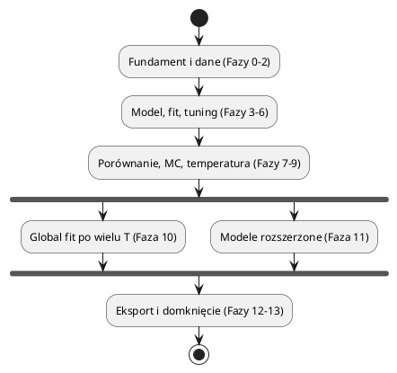

# JFM — Roadmap implementacji

**Status:** plan faz implementacji, na bazie `JFM_functional_specification.md` i `jfm-scientific-research-perplexity.md`. Zaktualizowano o realny stan implementacji na branchu `JFM-prototype` (`SST-Prototypes`) oraz o odniesienie do nowego dokumentu projektowego auto-zakresu i prefitu.
**Zasada:** Core gotowy (~99%) — JFM to czysty moduł domenowy budowany na nim, bez node editora i systemu pluginów.
**Podejście:** implementacja wzdłuż pipeline'u analizy — każda faza kończy się wynikiem widocznym na wykresie, zanim przechodzimy dalej.
**Data:** 2026-07-05. **Audyt stanu i aktualizacja:** 2026-07-14.
**Dokumenty powiązane:** `algorithm-description.md` (warstwa algorytmiczna, powstała równolegle 2026-07-05), `current-user-functionality.md` (audyt legacy JFM na `SemiconductorStudio@workin-sjcm`), `JFM-prefit-autorange-design.md` (specyfikacja API auto-zakresu i prefitu — szczegóły do Fazy 2 i Fazy 3, patrz niżej).

---

## Status realizacji (audyt 2026-07-14)

Audyt objął branch `JFM-prototype` repozytorium `SST-Prototypes` (ostatni commit audytowany: `2c2bf7b`). Poniższe dotyczy pracy **ponad** to, co było jawnie wypunktowane w Fazach 0-1 — realny zakres architektoniczny okazał się szerszy niż plan zakładał explicite, ale mieści się w duchu Fazy 0/1 (fundament + import), więc numeracja faz się nie zmienia.

- **Refaktor warstwy IO/runtime domknięty.** Wszystkie punkty z sesji „Codex — odniesienie techniczne i plan naprawy” (`notes.md`) w sekcjach *architektura* i *model danych* są oznaczone jako zrobione: `Application::Get()` wyzerowany w JFM, `RuntimeServices` jako jawny agregat uchwytów (`EventBus`, `JobSystem`, `ProgressTracker`, `CommandRegistry`, notifier, config), `JFMIORegistration` rozbity na osobne funkcje (import requested/progress/completed/failed, export, save, load), `JFMCharacteristicInfo`/`JFMCharacteristicData` rozdzielone, `Workspace` jako jedyny właściciel projektu i registry charakterystyk z API `AddSeries`/`AddCharacteristics`/`FindCharacteristic`/`FindCharacteristicByName`/`DeleteCharacteristic`/`MoveCharacteristic`, `sourcePath` jako `Path`. To bezpośrednio rozstrzyga pięć otwartych pytań architektonicznych IO, które wcześniej blokowały dalszą pracę (podział odpowiedzialności `IOLayer`/obiekty IO/joby/serializery/workspace store; `Application::Get()` → zero w JFM; itd.).
- **Warstwa algorytmiczna zaprojektowana koncepcyjnie zanim ruszyła implementacja.** `algorithm-description.md` (2026-07-05) domyka analizę z sekcji „Otwarte pytania algorytmiczne” pytaniem wprost: „zanim da się to przełożyć na konkretne interfejsy” — dokładnie to zadanie zrealizował `JFM-prefit-autorange-design.md` dla warstwy auto-zakresu i prefitu (Faza 2 §a, Faza 3 §prefit).
- **Legacy JFM (`SemiconductorStudio@workin-sjcm`) przeaudytowany funkcjonalnie i błędowo.** `current-user-functionality.md` inwentaryzuje 24 funkcje do odtworzenia (§7) oraz 10 konkretnych błędów ze wskazaniem linii kodu (§6) — to jest teraz podstawowe źródło prawdy „co dokładnie robił stary JFM”, uzupełniające `jfm-scientific-research-perplexity.md` (co *powinien* robić naukowo poprawny JFM).
- **Python-side pattern ustalony na przykładzie importu.** Pakiet `python/jfm_import` (dataclassy `slots=True`, granica C++ przez zwykły `dict[str, Any]` ręcznie mapowany na `sst_jfm.*` w `cpp_adapter.py`, dynamiczne ładowanie skryptu użytkownika przez `importlib`, testy `pytest` z `monkeypatch` na module `sst_jfm`) — to jest konwencja, na której `JFM-prefit-autorange-design.md` buduje nowy pakiet `jfm_prefit`.

---

## Decyzje zakresu (przyjęte)

1. **Global fit po wielu temperaturach wchodzi do zakresu JFM** (nie JFM+). §13.5 spec. funkcjonalnej i §8 dokumentu naukowego sugerują odłożenie do JFM+, ale przyjęto wersję z §2 (pełny zakres, z globalnym fitem). Wymaga nowego obiektu domenowego, którego żaden z dokumentów źródłowych nie nazywa wprost — patrz Faza 10.
2. **Katalog modeli podstawowych budowany naraz.** `SD-0`, `SD-Rs`, `SD-Rsh`, `SD-RsRsh`, `SD-Iph` trafiają do jednej fazy (Faza 3), bo i tak wymagają tej samej infrastruktury solvera implicit (Lambert W, Newton/Halley).
3. **GPU równolegle z CPU od początku, przy każdym etapie z realnym solverem/optymalizacją**: katalog modeli (3), fit pojedynczy (4), fit wielu/serii (6), Monte Carlo (8), global fit (10), modele rozszerzone (11). UI, eksport i tuning nie dostają osobnej pracy GPU — korzystają z gotowych kerneli z wcześniejszych faz.

## Mapa faz

```
Fundament i dane (Fazy 0-2)
  -> Model, fit, tuning (Fazy 3-6)
  -> Porównanie, MC, temperatura (Fazy 7-9)
  -> równolegle (dowolna kolejność):
       - Global fit po wielu T (Faza 10)
       - Modele rozszerzone (Faza 11)
  -> Eksport i domknięcie (Fazy 12-13)
```

Wersja do wklejenia w docs MkDocs (PlantUML):



---

## Faza 0 — Fundament domenowy JFM na Core

**Walidacja wizualna:** pusty projekt i drzewo widoczne w UI.

**Status: ✅ zrealizowane, z solidniejszym fundamentem niż pierwotnie planowano.**

- Klasy domenowe: `Project`, `Series`, `Characteristic` istnieją jako realne typy w `src/Domain` (`JFMDomainLayer`, `JFMTypes`) i `src/Workspace` (`JFMWorkspaceStore`), nie tylko jako struktury danych — `FitRun`, `MonteCarloRun`, `DerivedAnalysis` nadal czekają na Fazę 4/8/9
- Osadzenie modułu JFM w systemie okien/paneli Core — gotowe (`src/Presentation/Panels`)
- Widok drzewa projektu zaimplementowany i rozszerzony ponad plan: `ProjectTreePanel` + `JFMOverviewPanel`, `CharacteristicDetailsPanel`
- Nowy projekt / nowa seria — gotowe, wraz z zapisem/odczytem YAML (`JFMProjectYamlSerializer`) i materializacją danych po wczytaniu (job uruchamiany po `ProjectLoadCompleted`)
- Ponad plan: warstwa `RuntimeServices` (agregat `EventBus`/`JobSystem`/`ProgressTracker`/`CommandRegistry`/notifier/config) eliminująca `Application::Get()` z JFM — to wykracza poza dosłowny zakres Fazy 0, ale było warunkiem koniecznym, by dalsze fazy (zwłaszcza 2-3, praca w tle na dużych zbiorach) nie dziedziczyły długu technicznego z warstwy IO

## Faza 1 — Import + kontrola jakości + wizualizacja surowych danych

**Walidacja wizualna:** zaimportowana rodzina charakterystyk na wykresie, kolorowana wg `T`.

**Status: ✅ zrealizowane dla ścieżki głównej; kilka podpunktów §4.5/§4.1 częściowe — patrz uwagi.**

- Parsery: `.dat`/`.txt` gotowe (`jfm_import.dat_parser`), plus parser formatu SCAPS `.iv` (`scaps_iv_parser`) — dodatek ponad literalny zakres §4.1, przydatny bo `example-data/scaps-batch-file.iv` jest częścią danych referencyjnych projektu. Rozpoznawanie/ręczne mapowanie kolumn `V`/`I`/`J` — gotowe przez `column_roles`/`ParseOptions` (§4.1–4.2)
- Odczyt temperatury: nazwa pliku i nagłówek — gotowe (`common.detect_temperature`); edycja ręczna po imporcie — status nieustalony w tym audycie, do zweryfikowania w UI (§4.3)
- Import pojedynczy/wielokrotny/katalogu, przypisanie do serii — gotowe, **wraz z rozszerzeniem ponad plan**: import zagnieżdżonych folderów z odtworzeniem struktury jako serii, pomijanie plików nie do zaimportowania bez przerywania całego importu (`notes.md`, sekcja folderów). Auto-sort po `T` — do potwierdzenia w UI (§4.4)
- Rejestracja zewnętrznych skryptów importu: **częściowe** — dynamiczne ładowanie pojedynczego skryptu użytkownika (`cpp_adapter._load_custom_parser`, `importlib`) działa, ale UI do przeglądania/dodawania/przeładowania wielu zarejestrowanych skryptów jako element projektu (z `notes.md`, „Opcje UI do dodania” pkt 1-2) nie jest jeszcze zbudowane — to zostaje jako otwarty podpunkt Fazy 1 (§4.1)
- QC: duplikaty, niemonotoniczność `V` (`non_monotonic_sweep` warning), brak `T` — gotowe; braki kolumn/jednostki domyślne, saturacja/compliance, wiele sweepów + rozdzielanie — status nieustalony w tym audycie, prawdopodobnie częściowe (§4.5)
- `ImportStatusPanel` — gotowe, statusy w UI nie w konsoli (§18.1)
- `RawPlotPanel` — gotowe dla skali liniowej/log; signed-log nieustalony w tym audycie (§14.1–14.2)
- Minimalny eksport `.tsv` danych surowych (`JFMExportRawTsvJob`) — gotowe

**Mały dodatek do zakresu (uzgodniony, nie zmienia funkcjonalności):** `short_name_pattern` istnieje dziś jako pole `ParseOptions` przekazywane per-import. Doprecyzowanie: dodać **user-preset** — zapisywalny, nazwany zestaw wzorców (`name_pattern`/`short_name_pattern`/`custom_variables`) wybieralny z listy w oknie importu, żeby nie wpisywać wzorca ręcznie przy każdym imporcie tej samej serii pomiarowej. To rozszerzenie panelu importu (§15.1 UI z `notes.md`, pkt 5), nie zmiana modelu danych charakterystyki.

## Faza 2 — Preprocessing + zakres dopasowania

**Walidacja wizualna:** raw/processed/ranged rozróżnialne na wykresie, granice zakresu przeciągane myszką.

**Status: ⬜ implementacja C++/UI nierozpoczęta — ale zakres automatyczny (§6.1) jest teraz w pełni zaprojektowany na poziomie API, patrz `JFM-prefit-autorange-design.md`.**

- Konwersja jednostek, `I`↔`J`, korekta znaku jako jawna akcja — nierozpoczęte (§5.1)
- Duplikaty/wyłączanie punktów z fitu/log operacji — nierozpoczęte na tym poziomie (odrębne od QC importu z Fazy 1) (§5.1)
- Zakres manualny: panel + uchwyty na wykresie — nierozpoczęte (§6.2)
- **Zakres automatyczny — zaprojektowany, nierozpoczęty w kodzie.** `JFM-prefit-autorange-design.md` doprecyzowuje §6.1 tej specyfikacji i §7.1–7.2 dok. naukowego jako konkretny, gotowy do implementacji algorytm: maskowanie fizyczne → dolna granica (uogólnienie progu `3·V_T(T)` zamiast stałej wartości) → górna granica (detekcja rolloff/compliance z progiem względnym) → wewnętrzna segmentacja shunt/exponential/series na potrzeby prefitu (Faza 3). Uruchamiane po stronie Pythona, jako część automatyzacji poimportowej — zgodnie z decyzją podjętą w tej sesji, że auto-zakres i prefit żyją na poziomie preprocessingu/automatyzacji po imporcie, nie w osobnym kroku UI
- Zakres jako atrybut przyszłego `FitRun` — koncepcyjnie ustalone (`FitRangeResult` w nowym dokumencie), implementacja czeka na Fazę 4 (§6.3)
- Status zewnętrznych skryptów preprocessingu/walidacji — nierozpoczęte (§5.2)

## Faza 3 — Katalog modeli podstawowych + solver CPU/GPU + prefit

**Walidacja wizualna:** krzywa prefit nałożona na dane, dla każdego z modeli katalogu.

**Status: ⬜ implementacja nierozpoczęta — ale prefit ma teraz kompletną, gotową do wdrożenia specyfikację API; katalog modeli doprecyzowany z 5 do 10 jawnych wariantów.**

- Modele: `SD-0`, `SD-Rsh` (jawne `I(V)`); `SD-Rs`, `SD-RsRsh` (implicit) (§7.1 spec., §1.2 dok. nauk.) — nierozpoczęte
- **Doprecyzowanie nazewnictwa katalogu (nie zmiana zakresu funkcjonalnego):** zamiast jednego ogólnego `SD-Iph` z niejasnym zestawem parametrów, katalog Fazy 3 obejmuje jawnie 10 identyfikatorów: `SD-0`, `SD-Rs`, `SD-Rsh`, `SD-RsRsh` (dark) oraz ich odpowiedniki `-I_ph` (light), plus `SD-RsRsh-alpha-Rsh2` i `SD-RsRsh-alpha-Rsh2-I_ph` (odpowiednik legacy `SD-PLsh`/„6P”/„7P”). Pełna tabela model → parametry → bloki prefitu w `JFM-prefit-autorange-design.md` §c. To pokrywa się z pierwotnym zamysłem tej fazy (jedna infrastruktura solvera implicit dla całej rodziny `SD-*`), tylko z jawnym nazewnictwem zamiast skrótu „5 modeli”
- Solver implicit (Lambert W + Newton/Halley) — nierozpoczęty, poza zakresem nowego dokumentu prefitu (prefit dostarcza tylko wartości startowe, nie sam solver)
- CPU/GPU parytet — nierozpoczęty
- Parametry estimated/initial/fitted/tuned, bounds, skala log — nierozpoczęte w C++/UI; odpowiednik `ParameterEstimate` (wartość + błąd standardowy + źródło) istnieje już jako typ wynikowy prefitu w nowym dokumencie
- **Prefit — w pełni zaprojektowany, gotowy do implementacji.** `JFM-prefit-autorange-design.md` specyfikuje: sekwencję estymacji (`R_sh` → `A`/`I_0` z regionu semi-log → `R_s` metodą Cheunga → `I_ph` z interpolacji przy `V=0`), wspólny prymityw dopasowania liniowego Levenberg–Marquardt reużywany przez wszystkie bloki, mechanizm przeskalowania `A` oparty na tabeli korekcyjnej z `PreFitter.cpp` (`SemiconductorStudio@workin-sjcm`) przeniesiony jako osobny, wymienny komponent kalibracyjny, oraz rejestr modeli, w którym dodanie nowego modelu to nowy wpis deklaratywny, nie nowy kod numeryczny. Zawiera też algorytm automatycznego doboru najmniejszego wystarczającego modelu (test istotności `R_s`/`R_sh` + tani pseudo-`ΔAICc` na rezyduach prefitu) — realizuje ideę z `notes.md`/`current-user-functionality.md` (legacy „spróbuj 4P, eskaluj do 6P przy błędzie”), tylko podjętą świadomie na etapie prefitu zamiast post-hoc po nieudanym ficie
- Identyfikacja modelu przez składniki fizyczne — konwencja nazewnicza już przyjęta i używana w nowym dokumencie (§7 spec.)

## Faza 4 — Fit pojedynczej charakterystyki (CPU/GPU) + ocena wyniku

**Walidacja wizualna:** dopasowana krzywa + `chi²`/residua na ekranie.

- Solver fitu (Simplex — kontynuacja istniejącej funkcjonalności) w wersji CPU i GPU + test zgodności (§9.1, §19 pkt 7)
- Obiekt `FitRun`: model, zakres, initial values, fixed/free, bounds, wynik, błędy, status (§3.4)
- Raport: status (sukces/fail/przerwany/podejrzany/na granicy), reduced `chi²`, `Δchi²`, iteracje/ewaluacje, flagi granic/niefizyczności, residua, krzywa, config (§9.2)
- Trace Simplexa dla pojedynczego przebiegu debugowego (§9.3) — bez rozszerzania na MC
- Start od „fit aktywnej charakterystyki”; „zaznaczone/seria” startują tu, dojrzewają w Fazie 6
- Warstwy na wykresie: raw/ranged/fitted (+ tuned jako placeholder), residua jako osobny panel (§14.1, §14.3)

## Faza 5 — Tuning ręczny

**Walidacja wizualna:** suwak parametru natychmiast zmienia krzywą tuned.

- Równoległe widoki estimated/fitted/tuned (§11.1)
- Live preview krzywej tuned, niezależnej od fitted (§11.2)
- Przeniesienie tuningu: tuned→initial, tuned→fixed, przepisanie do configu kolejnego fitu, undo, reset tuned→fitted (§11.3)
- Tryb auto-fit po zmianie tuningu, jawnie włączany (§11.4)

## Faza 6 — Fit wielu charakterystyk/serii + zarządzanie UI

**Walidacja wizualna:** zaznaczenie całej serii + jeden klik → wszystko dopasowane, statusy w drzewie.

- Multi-select: pojedyncze, Ctrl, Shift, drag, cała seria, odwrócenie (§15.2)
- Context menu: hide/unhide, select/invert, change model, set dark/light, fit selected, run MC selected, color preset, remove, export selected (§15.3)
- Statusy w drzewie: zaimportowane, wymaga prefit, fitted, fit failed, MC available, warning, excluded, model candidate, result outdated (§15.4)
- Fit wielu modeli kandydackich naraz dla tej samej charakterystyki (przygotowanie pod Fazę 7)
- Naturalne miejsce na realny zysk z GPU batch (wiele charakterystyk naraz) — warto zmierzyć różnicę względem CPU

## Faza 7 — Porównanie modeli (podstawowych)

**Walidacja wizualna:** tabela zestawiająca 5 modeli z rekomendacją.

- Uruchomienie kilku modeli kandydackich, zestawienie parametrów / reduced `chi²` / `Δchi²` / liczby parametrów / flag niefizyczności / residuów (§10)
- AICc/BIC (§14.1 dok. nauk.), filtr fizyczności (§14.2), ranking z modelami „prawie równoważnymi” przy `ΔAIC < 2` (§14.3)
- Rekomendacja jako sugestia, nie decyzja ostateczna — użytkownik nadpisuje (§10)

## Faza 8 — Monte Carlo (CPU/GPU) i niepewności

**Walidacja wizualna:** chmura punktów/rozkład parametrów po serii MC.

- Uruchamianie: aktywna/zaznaczone/cała seria; wiele niezależnych MC runów per `FitRun`; inny seed; porównanie runów (§12.1)
- Konfiguracja: liczba iteracji, model i poziom szumu, seed (w ustawieniach numerycznych), liczba zapisywanych próbek, presety (§12.2)
- MC batch na GPU (tysiące refitów równolegle) + CPU, test zgodności statystyk przy tym samym seedzie/konfiguracji
- Wyniki: rozkłady, scatter dla par parametrów, elipsoidy kowariancji, poziomy `Δchi²`, korelacje, statystyki centralne, percentyle, nieudane przebiegi + odsetek, parametry na granicach (§12.3)
- Niepewności empiryczne z MC jako główne źródło (§12.4); macierz kowariancji z fitu jako szybki dodatek

## Faza 9 — Analiza temperaturowa per-T i Arrhenius

**Walidacja wizualna:** `A(T)`, `I_0(T)` i wykres Arrheniusa z dopasowaną prostą i `E_a`.

- Wykresy parametrów vs `T`: `I_0`/`J_0`, `ln(I_0)`, `A`, `R_s`, `R_sh`, `alpha`, `R_sh2` (jeśli dotyczy), parametry light (§13.1)
- Wybór osi: `T`, `1/T`, `1000/T`, `1/(kT)`, plus `1/(A·kT)` dla wykresów ideality-zależnych (§13.2)
- Arrhenius: `ln(I_0)` vs `1000/T` i vs `1/(kT)`, `A·ln(I_0)` vs `1/(kT)`, dopasowanie liniowe → nachylenie/przecięcie/`E_a` z poprawną konwersją zależną od osi (§13.3, tabela §6.5 dok. nauk. — krytyczne, żeby nie pomylić konwencji)
- Wiele serii, wiele dopasowań na serię, porównania serii (§13.4)
- Propagacja niepewności (`ln I_0`, `A·ln I_0`, `E_a` z nachylenia) z pełną kowariancją `A`–`I_0` (§11.2 dok. nauk.), zasilana danymi z MC (Faza 8)

## Faza 10 — Global fit fizyczny po wielu temperaturach

*(równolegle z Fazą 11)*

**Walidacja wizualna:** jeden fit obejmujący całą rodzinę `T`, z parametrami wspólnymi zaznaczonymi w UI.

- Krótki design pass przed kodem: żaden dokument nie nazywa tego obiektu — zdefiniować odpowiednik `FitRun` na wielu `Characteristic` + model + podział parametrów wspólne/per-T; warto spisać jako mini-ADR, zgodnie z konwencją projektu
- UI do oznaczania parametrów jako global (np. stałe `A`, albo `E_a` jako bezpośrednio fitowany) vs per-T wolne
- Wspólna funkcja celu: stackowanie residuów po wszystkich włączonych `T`, jedna minimalizacja `chi²`
- CPU + GPU równolegle (prawdopodobnie najcięższy numerycznie etap w całym JFM), test zgodności
- Porównanie ze Strategią A (Faza 9) — czy narzucenie wspólnych parametrów istotnie pogarsza dopasowanie
- Raport: globalne `E_a` i parametry wspólne + niepewności, parametry per-T + niepewności, wspólne `chi²`/dof
- Nadal poza zakresem (bez zmian): pełna automatyczna interpretacja mechanizmu Raua, analiza odwrotna (§13.5)

## Faza 11 — Katalog modeli rozszerzonych

*(równolegle z Fazą 10)*

**Walidacja wizualna:** `TE-IR`/`TE-SCR` dają sensowne `A'(T)`/`1/A(T)` na realnych danych heterozłącza.

- `2D-RsRsh`/`2D-Iph` (Lambert W częściowo + Newton), `TE-IR` (`A'(T)`), `TE-SCR` (`1/A(T)`), `BTD` (rozwiązanie dwuetapowe), `SD-PLsh` (potęgowy bocznik), `SCLC` (diagnostyczny, log-log)
- CPU + GPU dla każdego, ta sama zasada parzystości co w Fazie 3
- Jawny status per model: routine/eksperymentalny/diagnostyczny/wymaga ręcznej interpretacji, widoczny w UI i eksporcie (§7.3)
- Wykresy diagnostyczne: `A(T)·T` i `1/A(T)` (rozszerzenie Fazy 9), log-log `J-V` dla `SCLC`, widok roll-over/cross-over dla `BTD`
- Zastrzeżenie w UI: wynik modelu rozszerzonego nie jest automatycznym dowodem mechanizmu fizycznego (§7.3)
- Pełny zestaw modeli barierowych/wielobarierowych pomijamy — dokument sam oznacza to „do przedyskutowania”

## Faza 12 — Eksport pełny + persystencja projektu

**Walidacja wizualna:** komplet `.tsv` gotowy do OriginPro, projekt zapisuje się i wczytuje.

- Parametry (`.tsv`): seria, charakterystyka, `T`, dark/light, model, zakres, fitted, niepewności, reduced `chi²`, `Δchi²`, status, flagi (§17.1)
- Krzywe: raw, ranged, fitted, tuned, residua, wartości per model kandydacki (§17.2)
- MC: surowe wyniki, parametry iteracji, `Δchi²`, status iteracji, percentyle, macierz kowariancji/dane do jej odtworzenia, scatter — jeden MC run = jeden jednoznaczny zestaw plików (§17.3)
- Arrhenius/pochodne: punkty, przeliczone osie, dopasowania liniowe, nachylenia, przecięcia, `E_a`, niepewności, opis zakresu `T` (§17.4)
- Brak zależności od Pythona dla tej podstawowej ścieżki (§17.5)
- Proste zapisz/wczytaj stan projektu (§2) — formalne domknięcie tutaj; jeśli w trakcie prac zabraknie tego wcześniej (żeby nie tracić długich sesji fitowania), warto wyciągnąć okrojony autosave poza kolejnością

## Faza 13 — Domknięcie: przegląd błędów/ostrzeżeń + 17 warunków ukończenia

**Walidacja wizualna:** przejście checklisty §19 od góry do dołu bez wyjątków.

- Systematyczny przegląd całej aplikacji pod kątem §18: import/fit/MC — statusy i błędy widoczne w UI, nie w konsoli
- Domknięcie ewentualnych luk w parzystości CPU/GPU (§19 pkt 7)
- Formalne przejście listy 17 warunków z §19, punkt po punkcie
- Ostatnia weryfikacja granicy JFM/JFM+ — czy global fit (teraz w zakresie) jest dobrze ograniczony i nic z JFM+ się nie wkradło

---

## Źródła

- `JFM_functional_specification.md`
- `jfm-scientific-research-perplexity.md`
- `PROJECT_CONTEXT.md`
- `algorithm-description.md` — warstwa algorytmiczna (2026-07-05), uzupełniona przez ten audyt o konkretną specyfikację API dla §4-5
- `current-user-functionality.md` — audyt funkcjonalny i błędowy legacy JFM, `SemiconductorStudio@workin-sjcm`, commit `f69295a` (2026-06-26)
- `notes.md` — notatki robocze + sesja „Codex — odniesienie techniczne i plan naprawy” (2026-07-10), źródło statusów w tym audycie
- `JFM-prefit-autorange-design.md` — nowy dokument: specyfikacja auto-zakresu, prefitu i doboru modelu (2026-07-14)
- `SemiconductorStudio@workin-sjcm:JFMServices/Fitting/PreFitter.hpp/.cpp` — referencyjna implementacja C++ przeskalowania prefitu, cytowana w nowym dokumencie

---

*Dokument roboczy projektu JFM. Wersja 1.0, 2026-07-05. Audyt stanu i uzupełnienie: wersja 1.1, 2026-07-14.*