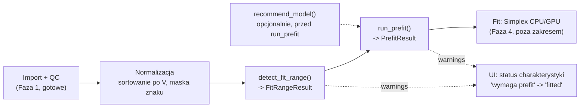

# JFM — Automatyczny zakres danych i Prefit: specyfikacja projektowa

**Status:** specyfikacja gotowa do implementacji (Python), uzupełnia `algorithm-description.md` §4–5 i doprecyzowuje `JFM-implementation-plan.md` Fazę 2 (§6.1) oraz Fazę 3 (prefit).
**Zakres:** automatyczny dobór zakresu dopasowania oraz estymacja parametrów startowych (prefit) dla 10 modeli z rodziny `SD-*`. Wykonywane po stronie Pythona, jako część automatyzacji poimportowej (preprocessing) — przed właściwym fitem (Faza 4, poza zakresem tego dokumentu).
**Data:** 2026-07-14.

---

## 0. Jak czytać ten dokument i skąd wzięły się decyzje

Trzy źródła bezpośrednio determinują poniższe decyzje, i każda sekcja odwołuje się do nich wprost zamiast je powielać:

1. **`jfm-scientific-research-perplexity.md`** (§7, §9.2, §16.3) — naukowe uzasadnienie *dlaczego* dany region charakterystyki `I(V)` nadaje się do estymacji danego parametru.
2. **`algorithm-description.md`** (§4–5) — koncepcyjny szkic tego samego algorytmu, już przyjęty w projekcie. Dokument jawnie deklaruje swój cel jako „materiał wejściowy przed projektowaniem API" i kończy się sekcją §12 „Otwarte pytania algorytmiczne przed projektowaniem API". Ten dokument jest odpowiedzią na to zadanie: to samo podejście, tylko z konkretnymi typami, sygnaturami i podziałem na moduły.
3. **`SemiconductorStudio@workin-sjcm:JFMServices/Fitting/PreFitter.hpp/.cpp`** — działająca, przetestowana na realnych danych implementacja C++ tego samego problemu z poprzedniej generacji JFM. To nie jest materiał czysto historyczny: `PreFitter` zawiera mechanizm empirycznej korekcji obciążenia estymatora `A` (tabela `m_AMultiplier` + `adjustCoefficient`), który nie wynika z żadnego wzoru w dokumencie naukowym — to wiedza wyłącznie empiryczna, zdobyta wcześniejszym testowaniem na realnych pomiarach. Ten projekt świadomie **dziedziczy mechanizm** tej korekcji (jako osobny, wymienny komponent), ale **nie dziedziczy jej dosłownej implementacji** — `PreFitter.cpp` zawiera co najmniej dwa realne błędy (§3.4, §3.5) i jeden estymator (`I_0` z pojedynczego punktu zamiast z regresji), którego jakość poprawiamy przy okazji tego samego refaktoru — zgodnie z wprost sformułowaną prośbą, żeby `A`/`I_0` powstawały z prawdziwego fitu liniowego, nie z odczytu jednego punktu.

Wszystkie trzy źródła są ze sobą spójne co do **struktury** algorytmu (region blisko `V=0` → `R_sh`; region wykładniczy → `A`, `I_0`; region wysokich `V` → `R_s`), różnią się poziomem rygoru statystycznego. Ten dokument bierze strukturę z `PreFitter` (sprawdzona w boju), rygor z `algorithm-description.md`/dokumentu naukowego (WLS zamiast dwupunktowej siecznej), i owija to w API zaprojektowane pod **rejestr modeli**, a nie pod cztery zahardkodowane klasy jak w legacy.

## 1. Architektura pipeline'u

Cały dokument dotyczy **jednego** kroku w pipeline JFM, między importem (Faza 1, gotowe) a właściwym fitem (Faza 4, poza zakresem):



Trzy nowe typy wyników (`FitRangeResult`, `PrefitResult`, `ModelRecommendation`) są zaprojektowane tak, by każdy z nich samodzielnie odpowiadał na pytanie „co się stało i dlaczego" — żaden nie zakłada, że wywołujący zna wewnętrzne działanie algorytmu. To bezpośrednia konsekwencja tego, że `Characteristic` w drzewie projektu (§15.4 spec. funkcjonalnej) musi umieć pokazać status `wymaga prefit` / `warning` / `model candidate` na podstawie tego, co te funkcje zwrócą — nie na podstawie zaglądania w ich wnętrze.

**Miejsce w architekturze:** pipeline uruchamia się po stronie Pythona (ustalone dla tej sesji), analogicznie do istniejącego `jfm_import` — jako krok automatyzacji poimportowej wywoływany przez `ScientificRuntime`, z wynikiem przekładanym na `sst_jfm.*` w warstwie adaptera (§6.6), tym samym mechanizmem co dziś `cpp_adapter.import_file`.

---

## 2. (a) Automatyczny dobór zakresu danych

### 2.1 Dwa różne pojęcia „zakresu" — rozróżnienie kluczowe dla API

Czytanie `PreFitter.cpp` ujawnia coś, czego żaden z dokumentów źródłowych nie mówi wprost, a co jest architektonicznie ważne: legacy JFM ma **dwa niezależne mechanizmy zakresu**, o różnym przeznaczeniu:

|                        | `RangeData()` / `getLowerRange`+`getUpperRange`                            | `estimateRsh`/`estimateRs` (`AStart`, `AEnd`)                                   |
| ---------------------- | -------------------------------------------------------------------------- | ------------------------------------------------------------------------------- |
| Co wyznacza            | Zgrubny zakres całej charakterystyki do właściwego fitu (`FitRun`, Faza 4) | Wewnętrzny podział *tego samego* zakresu na pod-okna na potrzeby samego prefitu |
| Ziarnistość            | Jedna para indeksów `(start, end)`                                         | Trzy pod-okna: shunt / exponential / series                                     |
| Gdzie żyje w nowym API | `FitRangeResult.fit_range`                                                 | `FitRangeResult.segmentation`                                                   |
| Konsument              | Faza 4 (Simplex), eksport zakresu (§6.3 spec. funkcjonalnej)               | Wyłącznie bloki prefitu (§3)                                                    |

Rozdzielenie tych dwóch pojęć w jawnym typie (`FitRangeResult` ma **oba** pola, nie jedno) jest świadomą decyzją: `fit_range` odpowiada na pytanie „które punkty w ogóle biorą udział w dopasowaniu", `segmentation` odpowiada na pytanie „który podzbiór *tych* punktów najlepiej reprezentuje dany mechanizm fizyczny". Scalenie ich w jedno pole zmusiłoby przyszły `FitRun` do przenoszenia informacji, która go nie dotyczy.

### 2.2 Precondition

`detect_fit_range()` **zakłada** dane wejściowe: `voltage` posortowane rosnąco, bez duplikatów, bez `NaN`/`inf`. To jest odpowiedzialność Fazy 1 (QC importu już to sprawdza — §4.5 spec. funkcjonalnej) i przyszłej Fazy 2 (preprocessing: deduplikacja, korekta znaku). Auto-zakres i prefit **nie duplikują** tej logiki. Uwaga z audytu danych referencyjnych: plik `example-data/C002/.../IV_C002_Z015_6_350,0K.dat` ma `V` malejące (sweep od `V=1.0` w dół) — sortowanie nie jest formalnością; bez niego cały poniższy algorytm (zwłaszcza detekcja rolloff, §2.5) działa na odwrotnej krawędzi danych.

### 2.3 Krok 1 — maskowanie fizyczne (twardy filtr)

Zgodnie z `algorithm-description.md` §5.1: odrzucenie punktów, dla których znak `I` jest niezgodny z trybem charakterystyki. To bezpośrednie uogólnienie warunku `I < 0.0` z `PreFitter::getLowerRange` — w legacy zaszyte tylko dla trybu dark. Nowa wersja bierze `characteristic_type` z `Sample` i stosuje właściwą maskę (dla `light` ujemne `I` przy `V < V_OC` jest fizycznie poprawne, nie odrzucane).

### 2.4 Krok 2 — dolna granica (odcięcie regionu `R_sh`/generacji)

Legacy (`getLowerRange`) liczy próg jako **stałą wartość** `V < 0.1`. Działa przy 300 K (`3·V_T ≈ 3 × 0.02585 V ≈ 0.078 V`, więc `0.1 V` to sensowne, choć przypadkowe przybliżenie) i **przestaje działać** przy niskich temperaturach z rodziny pomiarowej JFM: przy 100 K `3·V_T ≈ 0.026 V`, więc próg `0.1 V` odcinałby prawie cały region wykładniczy.

**Nowa reguła** — próg wyrażony przez temperaturę, nie przez stałą, wprost z §7.1 dokumentu naukowego („Okolice V=0: |V| < 3kT/q"):

$$
V_{\text{lower}} = n_\sigma \cdot V_T(T), \qquad V_T(T) = \frac{kT}{q}, \qquad n_\sigma = 3 \ \text{(domyślnie, konfigurowalne)}
$$

Indeks dolnej granicy = pierwszy indeks, dla którego jednocześnie `I ≥ 0` (po masce z §2.3) i `V ≥ V_lower`, plus mały margines bezpieczeństwa (legacy dodaje stałe `+3` punkty — zachowane jako domyślny `margin_points`, konfigurowalny).

### 2.5 Krok 3 — górna granica (detekcja rolloff / compliance limit)

Legacy (`getUpperRange`) skanuje od najwyższego `V` w dół, porównując każdy punkt ze średnią ruchomą kolejnych 5 punktów, z **progiem bezwzględnym `0.0001 A`**. To realny problem skalowalności: dane JFM obejmują prądy od pA do A (§20 pkt 2 dok. naukowego) — próg `10⁻⁴ A` jest bez znaczenia dla pomiaru rzędu pA i zbyt agresywny dla pomiaru rzędu A. Dane referencyjne (`IV_C002_Z015_6_350,0K.dat`) pokazują to zjawisko żywcem: sweep zaczyna się od plateau `I ≈ 0.0999989 A` (compliance limit aparatury) — dokładnie ten przypadek, który ten krok ma wyciąć.

**Nowa reguła** — ten sam mechanizm (skan od góry, okno `w=5` punktów, konfigurowalne), próg **względny** do lokalnej skali prądu zamiast stałej:

$$
\left|\, I_i - \overline{I}_{[i,\, i+w)} \,\right| < \varepsilon_{\text{rel}} \cdot \max\!\big(|I_i|,\ I_{\text{floor}}\big)
$$

gdzie `I_floor` to podłoga szumu aparatury — **ten sam parametr** co `σ_floor` z modelu szumu (§9.2 dok. naukowego), reużyty, nie zduplikowany. Semantyka pętli identyczna jak w legacy: dopóki punkt „pasuje" do lokalnej średniej (płaskie plateau = rolloff/compliance), skan kontynuuje w głąb; pierwszy punkt wyraźnie odstający od lokalnej średniej oznacza koniec plateau = górna granica. Zabezpieczenie z legacy (`if remaining < 20 points: fallback`) zachowane jako `min_remaining_points`.

### 2.6 Krok 4 — wewnętrzna segmentacja: shunt / exponential / series

Bezpośrednie uogólnienie `estimateRsh`+`estimateRs` (tabela §2.1). Legacy identyfikuje granicę segmentu **przez porównanie lokalnego nachylenia dwupunktowego do nachylenia siecznej od brzegu** (stosunek `S/S0` względem progu `0.8`) — tani, jednoprzebiegowy detektor punktu przegięcia. Zachowujemy dokładnie ten mechanizm do **wyznaczenia granic** okien (działa, jest tani, sprawdzony), ale — zgodnie z wprost sformułowaną prośbą — **wartości parametrów w tych oknach nie pochodzą już z dwupunktowej siecznej, tylko z pełnej regresji LM na całym oknie** (§3).

- **Okno `shunt`:** od `fit_range.lo` do indeksu, w którym `|S/S0| < shunt_ratio_threshold` (domyślnie `0.8`, jak w legacy) — sygnalizuje odejście od zachowania liniowego `I ≈ V/R_sh`.
- **Okno `series`:** od `fit_range.hi` w dół, symetryczne odbicie powyższego (legacy `estimateRs`) — do indeksu, w którym lokalne nachylenie zaczyna odpowiadać nachyleniu siecznej liczonej od góry.
- **Okno `exponential`:** to, co zostaje pomiędzy — dokładnie „Obszar I–II" dokumentu naukowego (§7.1: `3kT/q < V < V_knee`).
- `algorithm-description.md` §5.3 (PELT / formalna detekcja changepoint) — **świadomie odłożone jako v2** (§7 niżej, otwarte pytania): dwupunktowy detektor stosunku nachyleń jest tańszy, sprawdzony na realnych danych (legacy) i wystarczający jako punkt startowy dla Simplexa. PELT/Savitzky–Golay wchodzą w grę, jeśli po wdrożeniu v1 okaże się, że segmentacja jest zbyt niestabilna na mocno zaszumionych seriach.

### 2.7 Krok 5 (opcjonalny, v2) — kontrola stabilności

Dok. naukowy §7.2 i `algorithm-description.md` §5.4: dopasowanie dla zakresu `±10–20%` i porównanie `A` — zmiana `>5%` = zakres niestabilny. **Zaprojektowane, nie w v1**: `RangeOptions.stability_check` (domyślnie `False`) — po włączeniu `detect_fit_range()` wewnętrznie woła siebie dla przesuniętych granic i dopisuje `warnings += ("unstable_range",)` gdy próg przekroczony. Pole `warnings` istnieje w `FitRangeResult` od v1, więc włączenie tej opcji później nie zmienia kontraktu typu.

### 2.8 Skrót API (pełne typy w §6)

```python
def detect_fit_range(sample: Sample, options: RangeOptions | None = None) -> FitRangeResult:
    """Zwraca zgrubny zakres fitu ORAZ wewnętrzną segmentację shunt/exponential/series.

    Nie zależy od modelu docelowego (§6.2) — segmentacja jest własnością danych,
    nie wybranego modelu; to model (rejestr, §6.3) decyduje, których okien użyje.
    """
```

---

## 3. (b) Prefit — estymacja parametrów startowych

### 3.1 Jeden prymityw, reużywany wszędzie

Zgodnie z prośbą, żeby skrypty korzystały „z już dostępnych metod estymacji parametrów" — **cały prefit sprowadza się do wielokrotnego wywołania jednej funkcji**: dopasowania prostej metodą Levenberga–Marquardta.

```python
def fit_line_lm(
    x: np.ndarray,
    y: np.ndarray,
    weights: np.ndarray | None = None,
) -> LinearFitResult:
    """LM-fit prostej y = slope*x + intercept.

    `weights[i]` to waga 1/sigma_y[i]**2, nie odchylenie -- ta sama konwencja co
    w dokumencie naukowym §9.2 (w_i = (I_i/sigma_i)**2 dla regresji Arrheniusa).
    `weights=None` = fit nieważony.
    """
```

Implementacja: `scipy.optimize.curve_fit(line, x, y, p0=ols_guess, sigma=..., method="lm")` — `scipy` jest już zależnością projektu (`pyproject.toml`). Punkt startowy `p0` liczony tanio zamkniętą formułą OLS, żeby LM zbiegał w 2–3 iteracjach zamiast błądzić — LM na *prostej* to formalność numeryczna, ale trzymanie się jednego mechanizmu (zamiast „gdzieś OLS, gdzieś LM") jest tym, o co prosi zadanie: nowy blok = nowe wywołanie tej samej funkcji, nie nowa metoda estymacji.

Każdy blok prefitu (poniżej) to ten sam schemat: **wybierz okno** (z `segmentation`) → **przekształć osie** (np. `ln|I|` zamiast `I`) → `fit_line_lm(...)` → **przelicz `(slope, intercept)` na parametr fizyczny**. Dodanie nowego parametru, który *też* linearyzuje się w jakiejś transformacji osi — a większość w tym katalogu się linearyzuje, to teza otwierająca §4 `algorithm-description.md` — nie wymaga nowego solvera, tylko nowej pary transformacji osi + wzoru przeliczenia.

### 3.2 Blok `shunt` → `R_sh`

Region: `segmentation.shunt`. Model lokalny: `I = V/R_sh + c` (stała `c` dopuszczona, nie wymuszamy przejścia przez zero — realne dane mają offset).

```python
fit = fit_line_lm(sample.voltage[win.lo:win.hi], sample.current[win.lo:win.hi])
R_sh = 1.0 / fit.slope if fit.slope else math.inf
sigma_R_sh = abs(R_sh) * (fit.slope_stderr / abs(fit.slope)) if fit.slope else None  # propagacja przez 1/x
```

Odpowiednik `estimateRsh` w legacy, z dwiema różnicami: (1) wartość liczona z regresji na całym oknie, nie z siecznej dwupunktowej; (2) *granica* okna nadal wyznaczana tanim mechanizmem stosunku nachyleń (§2.6) — segmentacja i estymacja wartości to teraz dwa oddzielne kroki, tam gdzie legacy robił oba naraz.

Skrajny przypadek: puste okno `shunt` (dane zaczynają się już w regionie wykładniczym) → `R_sh = inf`, `source="shunt_block_fallback"`, warning `"shunt_window_unavailable"`. Fizycznie sensowne (brak wykrywalnego bocznika w granicach czułości pomiaru) i bezpieczne dla kroku semilog (odjęcie `V/R_sh` z `R_sh = inf` to brak korekty).

### 3.3 Blok `series` → `R_s` (metoda Cheunga)

Region: `segmentation.series`. Metoda Cheunga (§5.4 dok. naukowego, §4.4 `algorithm-description.md`) linearyzuje `R_s` wprost:

$$
\frac{dV}{d(\ln I)} = I \cdot R_s + \frac{AkT}{q}
$$

```python
dV_dlnI = numerical_derivative(voltage_win, np.log(current_win))  # różnice centralne w v1
fit = fit_line_lm(current_win[1:-1], dV_dlnI)
R_s = fit.slope
A_cheung_crosscheck = fit.intercept / thermal_voltage(T)   # NIEZALEŻNY estymator A, nie nadpisuje A z bloku semilog
```

`A_cheung_crosscheck` nie jest przypadkowym dodatkiem: dokument naukowy explicite poleca go jako niezależną weryfikację `A` z regionu semilogarytmicznego. Trafia do `PrefitResult.diagnostics["A_cheung_crosscheck"]` — dostępny dla UI/eksportu jako sygnał jakości, nie jako druga wartość `A` konkurująca z pierwszą. Różniczkowanie w v1 = różnice centralne na już-posortowanych danych okna; Savitzky–Golay (`algorithm-description.md` §4.6) to jawnie oznaczone rozszerzenie v2 (§7 niżej), bo poprawia odporność na szum kosztem dodatkowego parametru (szerokość okna wygładzania) do dostrojenia.

### 3.4 Blok `semilog` → `A`, `I_0` (+ przeskalowanie)

Region: `segmentation.exponential`, **po odjęciu prądu bocznika** oszacowanego w §3.2 — gdy dostępny (kolejność bloków w rejestrze modelu, §6.3, gwarantuje że `shunt` biegnie przed `semilog` dla modeli, które w ogóle mają `R_sh`):

```python
R_sh_est = ctx.estimates.get("Rsh")  # None dla modeli bez shunt-bloku (SD-0, SD-Rs, ...)
I_corr = current_win - voltage_win / R_sh_est.value if (R_sh_est and math.isfinite(R_sh_est.value)) else current_win

y = np.log(np.abs(I_corr))
weights = (I_corr / noise_model(I_corr)) ** 2          # §9.2 dok. naukowego: w_i = (I_i/sigma_i)**2
fit = fit_line_lm(voltage_win, y, weights=weights)

Vt = thermal_voltage(T)
A_raw = 1.0 / (fit.slope * Vt)
A = A_raw * options.bias_correction.evaluate(window_width_volts(win))
```

To jest kluczowa różnica względem legacy, więc zasługuje na precyzyjne porównanie obu wersji.

**Co robi legacy (`estimateIdealityFactor`):** liczy `d(ln I)/dV` **punktowo** — różnica skończona `(logI[i+2]-logI[i]) / (V[i+2]-V[i])` dla każdego `i` w oknie — i bierze **maksimum** tej punktowej pochodnej (`maxDer`) jako estymator nachylenia: `A = 1/(k·T·maxDer)`. Branie maksimum z wielu zaszumionych, punktowych estymat pochodnej jest statystycznie obciążone (maksimum próbki szumu systematycznie przecenia prawdziwą wartość) — i dokładnie to koryguje tabela `m_AMultiplier`: mnożnik zależny od `dV` (szerokości „plateau" wokół maksimum, w woltach), interpolowany kawałkami liniowo, malejący przy wąskich plateau (mniej punktów uśredniających szum → silniejsze obciążenie → silniejsza korekta).

**Co robi ta specyfikacja:** zamiast punktowego maksimum — **pełna ważona regresja LM na całym oknie**, słabiej obciążona z samej konstrukcji (uśrednia po wielu punktach zamiast brać ekstremum próbki). Warstwa korekty (`bias_correction.evaluate(...)`) **zostaje w architekturze**, bo empiryczna korekta obciążenia prefitu jest ogólnie dobrą praktyką (dok. naukowy §18.1 wprost zaleca kalibrację na danych syntetycznych) — nie dlatego, że *ta konkretna tabela liczb* na pewno wciąż pasuje do *innego* estymatora. Zalecenie (do potwierdzenia w §7 niżej): wygenerować nową tabelę tą samą metodologią, jakiej najwyraźniej użyto dla legacy (dane syntetyczne o znanym `A_true`, zmienne `T`/szum/gęstość punktów, tabela `szerokość_okna -> mediana(A_true / A_raw)`) — to dokładnie procedura z §18.1 dok. naukowego, więc nie jest to praca dodatkowa ponad to, co JFM i tak musi zrobić do walidacji.

**`I_0` — druga zmieniona rzecz.** Legacy cofa się do **jednego, zaszumionego punktu danych** (w miejscu maksymalnej pochodnej) i odwraca przez niego prostą z już-skorygowanym `A`. Prośba mówi wprost: `I_0` ma pochodzić z fitu, nie z punktu:

```python
V_anchor = float(np.mean(voltage_win))                    # środek okna regresji, nie pojedynczy zaszumiony punkt
lnI_anchor = fit.slope * V_anchor + fit.intercept          # wartość WYGŁADZONEJ prostej w V_anchor
I_0 = math.exp(lnI_anchor - V_anchor / (A * Vt))            # przecięcie odtworzone przez już-skorygowane A
```

Dlaczego nie po prostu `exp(fit.intercept)`? Bo `fit.intercept` odpowiada **nieskorygowanemu** `fit.slope` (sprzed mnożenia przez `bias_correction`) — użycie go wprost dałoby parę `(A, I_0)` niespójną z żadną rzeczywistą prostą (przecięcie starej prostej, nachylenie nowej). Kotwiczenie w `V_anchor` (środek okna, nie brzeg) i przeliczenie przez już-skorygowane `A` daje parę spójną z regresją, odporną też na to, że okno mogło nie zawierać `V=0`.

### 3.5 Charakterystyki `light`: `I_ph` jako krok poprzedzający segmentację, nie blok

Modele `-I_ph` wymagają osobnej uwagi architektonicznej. Legacy ekstrakcji `I_sc` ma **dwa realne błędy** (§3.6 poniżej), ale poza błędami ma też ograniczenie koncepcyjne: liczy `I_sc` *po* uruchomieniu tej samej sekwencji shunt→series→semilog, którą stosuje dla danych dark — a charakterystyka `light` blisko `V=0` jest zdominowana przez `-I_ph`, nie przez zachowanie liniowe `R_sh`, więc segmentacja licząca na „zachowanie zbliżone do prostej blisko zera" jest tam wprowadzana w błąd.

Rozwiązanie zgodne z zasadą superpozycji (§17.1 dok. naukowego: `J_light(V) = J_dark(V) - J_SC`, z zastrzeżeniami o warunkach poprawności w §17.2) — **wystarczające dla prefitu**, nawet jeśli nie jest dokładne dla właściwego fitu fizycznego:

```python
def estimate_photocurrent(sample: Sample) -> ParameterEstimate:
    """I_ph z interpolacji liniowej przy V=0 (wymaga V posortowanego rosnąco, §2.2)."""
    i_ph = float(np.interp(0.0, sample.voltage, sample.current))
    extrapolated = not (sample.voltage[0] <= 0.0 <= sample.voltage[-1])
    return ParameterEstimate(
        value=i_ph, stderr=None, source="photocurrent_interp",
        warnings=("I_ph_extrapolated",) if extrapolated else (),
    )
```

Dla modeli z `I_ph` w liście parametrów, orkiestrator (§6.4) woła tę funkcję **przed** `detect_fit_range`, buduje `working_sample = replace(sample, current=sample.current + i_ph)` (przesunięcie o oszacowany fotoprąd — "dark-equivalent" krzywa robocza) i **dopiero na niej** uruchamia segmentację i pozostałe bloki. Finalny `PrefitResult` nadal raportuje oryginalny `sample`; `working_sample` jest wewnętrznym szczegółem implementacji, niewidocznym w kontrakcie typu. To jest powód, dla którego `I_ph`/fotoprąd **nie jest wpisany do listy `blocks` w rejestrze modelu** (§6.3) tak jak `shunt`/`series`/`semilog` — jest wyzwalany przez samą obecność `"I_ph"` w `parameter_names`, ponieważ musi zajść *przed* czymkolwiek innym, nie w jakimś miejscu w sekwencji.

### 3.6 Blok `nonlinear_shunt_defaults` → `alpha`, `Rsh2`

Tylko dla `SD-RsRsh-alpha-Rsh2[-I_ph]`. Legacy (`SixParameterModelPreFit`) używa stałych startowych: `alpha=2.0`, `Rsh2=R_sh` (z bloku §3.2). **Zachowane bez zmian** — nie dlatego, że nie da się tego lepiej wystartować (możliwy byłby mały, osobny nieliniowy LM na rezyduach okna `shunt` po odjęciu części liniowej), ale dlatego że: (a) dokument funkcjonalny (§7.3) i naukowy (§1.2, uwaga o `SD-PLsh`) opisują `alpha`/`Rsh2` jako parametry „diagnostyczne/użytkowe" bez czystej interpretacji mikrofizycznej — precyzyjny prefit nie daje tu tyle wartości co dla `A`/`I_0`; (b) to punkt startowy dla Simplexa (Faza 4), który i tak je doszlifuje; (c) zasada „Ponytail" tego repozytorium („nie twórz abstrakcji bez aktualnego zastosowania") — jeśli po Fazie 4 okaże się, że te dwa parametry regularnie nie zbiegają z tego startu, to sygnał żeby dodać właściwy blok, nie powód żeby go pisać teraz.

```python
def estimate_nonlinear_shunt_defaults(ctx: PrefitContext) -> None:
    rsh = ctx.estimates.get("Rsh")
    rsh2_value = rsh.value if (rsh and math.isfinite(rsh.value)) else 1.0e6  # sensowna podłoga, nie inf
    ctx.estimates["Rsh2"] = ParameterEstimate(value=rsh2_value, stderr=None, source="nonlinear_shunt_defaults_block")
    # `alpha` NIE jest tu ustawiane -- pochodzi z ModelSpec.defaults (stała, niezależna od danych), §6.3
```

### 3.7 Iteracyjne domknięcie sekwencji (v2)

`algorithm-description.md` §4.7: `R_sh` wpływa na okno użyte do `A`/`I_0`, `R_s` wpływa na górną granicę tego okna — całość to naturalnie punkt stały, 2–3 przebiegi zwykle wystarczają do zbieżności. **v1 = jeden przebieg** (kolejność bloków w rejestrze modelu, §6.3, już zapewnia że `shunt` poprzedza `semilog` tam, gdzie to potrzebne). Hook pod iterację: `PrefitOptions.refinement_passes: int = 1` — wartość `>1` każe orkiestratorowi powtórzyć sekwencję bloków, za każdym razem z lepszym `ctx.estimates` z poprzedniego przebiegu jako punktem odniesienia. Zero zmian kontraktu typów, żeby włączyć to później.

### 3.8 Błędy w `PreFitter.cpp` — świadomie NIE replikowane

Wymienione precyzyjnie, bo to repozytorium ma już konwencję dokładnego, liniowego audytowania takich rzeczy (`current-user-functionality.md` §6) — poniższe traktować jako kontynuację tej samej listy, nie nową kategorię:

| #   | Plik : linie                                                                                                           | Błąd                                                                                                                                                                                                                                                | Skutek                                                                                                                      | Co robi ta specyfikacja zamiast tego                                                                                                                                                  |
| --- | ---------------------------------------------------------------------------------------------------------------------- | --------------------------------------------------------------------------------------------------------------------------------------------------------------------------------------------------------------------------------------------------- | --------------------------------------------------------------------------------------------------------------------------- | ------------------------------------------------------------------------------------------------------------------------------------------------------------------------------------- |
| 1   | `PreFitter.cpp`, `estimateIdealityFactor` (linia z `double l = ...`)                                                   | `V[maxDerIndex]` używa `maxDerIndex` (indeks *lokalny* dla okna) wprost jako indeksu do **pełnej, nieprzyciętej** tablicy `V` — powinno być `V[AStart + maxDerIndex]`, dokładnie jak (nieużywana!) zmienna `l1` dwie linie niżej to liczy poprawnie | `I_0` liczone z niewłaściwego napięcia — błąd systematyczny zależny od `AStart`                                             | `V_anchor` liczone jako średnia okna `voltage_win`, które *jest już* wycięte do właściwego zakresu — nie ma osobnych „indeksów lokalnych" i „indeksów globalnych" do pomylenia (§3.4) |
| 2   | `PreFitter.cpp`, `FiveParameterModelPreFit::Estimate`                                                                  | `int index = ...` wewnątrz `if` **przesłania** zewnętrzną zmienną `index` (nowa zmienna lokalna dla bloku `if`) — zewnętrzny `index` używany niżej jest zawsze `0`, niezależnie od warunku                                                          | `I_sc` brane z `currentData[0]` zawsze, nawet gdy sweep zaczyna się poniżej `V=0` (typowy przypadek dla pomiaru dark+light) | `np.interp(0.0, ...)` — nie ma pojęcia „indeksu V=0" do przesłonięcia, bo nie ma żadnej gałęzi warunkowej (§3.5)                                                                      |
| 3   | `PreFitter.cpp`, `SevenParameterModelPreFit::Estimate` — **już udokumentowany w `current-user-functionality.md` §6.9** | `int index = *std::ranges::find(...)` dereferencjuje iterator (dając wartość `double ≈ 0.0`) zamiast liczyć jego offset (`std::distance`)                                                                                                           | `I_sc` efektywnie zawsze z okolic indeksu `0` po konwersji `double->int`                                                    | Jak wyżej — interpolacja, nie wyszukiwanie indeksu                                                                                                                                    |
| 4   | `PreFitter.cpp`, `PreFitter::RangeData`                                                                                | Komentarz w kodzie: `//FIX it to be more general` — funkcja zawsze woła `preFitterMap[Model4P]->RangeData(...)`, niezależnie od faktycznego modelu wejścia                                                                                          | Zakres wyznaczany zawsze regułą modelu 4P, nawet dla 6P/light                                                               | `detect_fit_range()` nie zależy od modelu w ogóle (§2.8) — nie ma czego pomylić, bo nie ma osobnej reguły per model do wyboru                                                         |

Wiersze 1–3 dotyczą wyłącznie `I_0`/`I_sc` — dokładnie tych dwóch wielkości, które ta specyfikacja świadomie przeprojektowuje na pełne regresje/interpolacje zamiast operacji na pojedynczych indeksach. To nie przypadek: operacje na pojedynczym, ręcznie wyliczanym indeksie są dokładnie tym rodzajem kodu, w którym tego typu błędy najłatwiej przechodzą niezauważone.

---

## 4. (c) Zastosowanie do 10 modeli katalogu

Każdy model to **kompozycja bloków** z §3, nic więcej. Kolumna „Bloki" to dokładnie wartość `ModelSpec.blocks` z rejestru (§6.3) — w tej kolejności, bo `semilog` musi widzieć wynik `shunt`, a `nonlinear_shunt_defaults` musi widzieć wynik `shunt`. `series` nie zależy od niczego innego (może biec w dowolnym miejscu po `shunt`), ale dla czytelności trzymany jest zawsze na tej samej pozycji.

| Model ID                   | `I(V)`                                        | Wolne parametry                         | Bloki (w kolejności wykonania)                     | `I_ph` pre-step (§3.5) | Odpowiednik legacy               |
| -------------------------- | --------------------------------------------- | --------------------------------------- | -------------------------------------------------- | :--------------------: | -------------------------------- |
| `SD-0`                     | `I0[exp(qV/AkT)-1]`                           | `I0, A`                                 | `semilog`                                          |           —            | brak wprost (referencyjny, „2P") |
| `SD-Rs`                    | `I0[exp(q(V-IRs)/AkT)-1]`                     | `I0, A, Rs`                             | `semilog, series`                                  |           —            | brak wprost („3P")               |
| `SD-Rsh`                   | `I0[exp(qV/AkT)-1] + V/Rsh`                   | `I0, A, Rsh`                            | `shunt, semilog`                                   |           —            | brak wprost („3P")               |
| `SD-RsRsh`                 | `I0[exp(q(V-IRs)/AkT)-1] + (V-IRs)/Rsh`       | `I0, A, Rs, Rsh`                        | `shunt, semilog, series`                           |           —            | `Model4P`                        |
| `SD-0-I_ph`                | `Iph - I0[exp(qV/AkT)-1]`                     | `I0, A, I_ph`                           | `semilog`                                          |           ✓            | brak wprost                      |
| `SD-Rs-I_ph`               | `Iph - I0[exp(q(V-IRs)/AkT)-1]`               | `I0, A, Rs, I_ph`                       | `semilog, series`                                  |           ✓            | brak wprost                      |
| `SD-Rsh-I_ph`              | `Iph - I0[exp(qV/AkT)-1] - V/Rsh`             | `I0, A, Rsh, I_ph`                      | `shunt, semilog`                                   |           ✓            | brak wprost                      |
| `SD-RsRsh-I_ph`            | `Iph - I0[exp(q(V-IRs)/AkT)-1] - (V-IRs)/Rsh` | `I0, A, Rs, Rsh, I_ph`                  | `shunt, semilog, series`                           |           ✓            | `Model4PLight`                   |
| `SD-RsRsh-alpha-Rsh2`      | jw. `SD-RsRsh` `+ (V-IRs)^alpha/Rsh2`         | `I0, A, Rs, Rsh, alpha`\*, `Rsh2`       | `shunt, semilog, series, nonlinear_shunt_defaults` |           —            | `Model6P`                        |
| `SD-RsRsh-alpha-Rsh2-I_ph` | jw. `+ Iph`                                   | `I0, A, Rs, Rsh, alpha`\*, `Rsh2, I_ph` | `shunt, semilog, series, nonlinear_shunt_defaults` |           ✓            | `Model6PLight`                   |

\* `alpha` nie pochodzi z żadnego bloku — jest stałą `ModelSpec.defaults = {"alpha": 2.0}`, zastosowaną przez orkiestrator na końcu (§6.4), niezależnie od danych (§3.6).

**Obserwacja o skalowalności (odpowiedź na wymóg „bardzo proste dodawanie nowego modelu"):** cztery modele dark (`SD-0`…`SD-RsRsh`) różnią się między sobą wyłącznie **obecnością** bloków `shunt`/`series` w liście — nie osobną logiką. Cztery modele light to te same cztery listy bloków plus jeden wspólny przełącznik (`I_ph` w `parameter_names`). Dwa modele z nieliniowym bocznikiem to `SD-RsRsh`/`SD-RsRsh-I_ph` plus jeden dodatkowy blok. **Żaden z 10 modeli nie wymagał nowej metody estymacji** — wszystkie korzystają z tych samych czterech bloków (`shunt`, `series`, `semilog`, `nonlinear_shunt_defaults`) i jednego pre-kroku (`I_ph`). To bezpośrednio pokazuje, że rejestr (§6.3) skaluje się tak, jak wymaga zadanie: nowy model w tej rodzinie to nowy wiersz w tabeli, nie nowy kod.

**Bonus zgodności na przyszłość:** `algorithm-description.md` §3.4 zauważa, że `TE-IR`/`TE-SCR` (Faza 11, poza zakresem tego dokumentu) dla *pojedynczej* temperatury mają dokładnie tę samą strukturę co `SD-Rs`/`SD-RsRsh`, tylko z `A'(T)` jako efektywną idealnością. Konsekwencja dla tego rejestru: prefit `TE-IR`/`TE-SCR` per-temperaturowy (§4.9 tegoż dokumentu) może być `ModelSpec` wskazującym na **te same bloki** co `SD-Rs`/`SD-RsRsh`, z inną etykietą parametru (`A'` zamiast `A`) — zero nowego kodu numerycznego w Fazie 11, tylko nowy wpis w rejestrze. To jest dokładnie test na to, czy architektura jest „skalowalna" w sensie, o który prosi zadanie.

---

## 5. Automatyczny dobór modelu minimalizujący liczbę parametrów

### 5.1 Cel i miejsce w pipeline

Odpowiedź na życzenie „algorytm, który na poziomie prefitu dobiera model tak, żeby minimalizować liczbę parametrów". To **nie jest** to samo co porównanie modeli z Fazy 7 (§10 spec. funkcjonalnej) — tamto porównuje **pełne wyniki fitu** (`reduced chi²`, `ΔAICc` na prawdziwym `chi²`) po tym, jak Simplex już zbiegł dla kilku kandydatów. To poniżej jest tańsze: decyzja **przed** uruchomieniem jakiegokolwiek Simplexa, żeby od razu zaproponować rozsądny punkt startowy zamiast zawsze proponować najbogatszy model z rodziny. Odpowiada bezpośrednio na to, co legacy robił bardzo prymitywnie (`current-user-functionality.md` §2 pkt 5: „jeśli błąd > 1×10⁻⁴ i model był 4P, automatycznie przełącza na 6P i ponawia dopasowanie" — czyli *eskalacja po fakcie*, dopiero gdy prostszy model już zawiódł w pełnym ficie). Tu decyzja zapada **przed** fitem, na podstawie tego, co prefit i tak już policzył.

### 5.2 Algorytm

Działa na **drabinie zagnieżdżonych kandydatów** w obrębie jednej rodziny (`dark` albo `light`, wybranej przez `characteristic_type` charakterystyki — modele z `alpha`/`Rsh2` nie wchodzą do automatycznej drabiny, patrz §5.4):

```
dark:  SD-0 ⊂ SD-Rs ⊂ SD-RsRsh          (SD-Rsh jako boczna gałąź: SD-0 ⊂ SD-Rsh)
light: SD-0-I_ph ⊂ SD-Rs-I_ph ⊂ SD-RsRsh-I_ph   (analogicznie SD-Rsh-I_ph jako boczna gałąź)
```

1. **Policz segmentację raz** (`detect_fit_range`, §2) — współdzielona przez wszystkich kandydatów, nie liczona osobno na model.
2. **Policz bloki `shunt` i `series` raz**, niezależnie od tego, który model ostatecznie ma je zawierać — to jest tania, pojedyncza regresja LM na model.
3. **Test istotności `R_sh`:** `R_sh` jest „istotny" (czarne na białym: bocznik realnie ogranicza dopasowanie), gdy `|1/R_sh| / sigma(1/R_sh) > z_threshold` (domyślnie `z_threshold=3`). Odwrotność, nie samo `R_sh`, bo to `1/R_sh` (przewodność bocznika) jest wielkością, która **znika** (→0, nie →∞) gdy bocznika nie ma — test na `R_sh` wprost miałby źle zachowującą się granicę.
4. **Test istotności `R_s`** analogicznie na `R_s`/`sigma(R_s)` z bloku `series`.
5. **Zbuduj listę kandydatów** z modeli w drabinie, których zestaw bloków pasuje do wyniku testów istotności (np. `R_sh` nieistotny, `R_s` istotny → kandydat `SD-Rs`), plus zawsze najprostszy (`SD-0`) i zawsze pełny (`SD-RsRsh`) dla porównania.
6. **Tani pseudo-`chi²` per kandydat:** dla każdego kandydata, zsumowane ważone rezydua bloku `semilog` (ten sam, już policzony fit — nie osobny fit na kandydata) — **nie** pełny fit na wszystkich punktach charakterystyki, tylko na oknie `exponential`, bo to jedyne okno wspólne dla wszystkich kandydatów w drabinie.
7. **`ΔAICc = Δ(pseudo_chi²) + 2·Δk`** — dokładnie skrót z `algorithm-description.md` §11.3 (na tym samym zbiorze danych i modelu szumu stała normalizacyjna log-wiarygodności się znosi).
8. **Rekomendacja:** model o najniższym pseudo-`AICc` wśród kandydatów spełniających testy istotności. Modele w paśmie `ΔAICc < 2` od najlepszego → oznaczone jako „niemal równoważne" w `reasoning`, nie odrzucone.
9. **To jest rekomendacja, nie decyzja** — zgodnie z ustaloną filozofią całego projektu (§10 spec. funkcjonalnej: „Rekomendacja modelu nie jest ostateczną interpretacją mechanizmu fizycznego. Użytkownik może nadpisać wybór modelu."). `run_prefit()` nadal działa dla dowolnego jawnie wybranego `model_id`, niezależnie od tego, co zwróci `recommend_model()` — te dwie funkcje są rozłączne w API (§6.5), żeby UI mogło swobodnie wywołać jedną bez drugiej.

### 5.3 Sygnatura

```python
def recommend_model(
    sample: Sample,
    family: Literal["dark", "light"],
    options: PrefitOptions | None = None,
) -> ModelRecommendation: ...
```

`family` jest jawnym argumentem, nie wyprowadzanym z `sample.characteristic_type` automatycznie — wywołujący (UI/Faza 6) może chcieć zapytać „a jak wyglądałby dobór modelu, gdybyśmy potraktowali to jako dark" nawet dla danych oznaczonych jako light (diagnostyka, nie częsty przypadek, ale tani do wsparcia skoro `family` i tak jest osobnym parametrem).

### 5.4 Świadomie poza automatyczną drabiną

`SD-RsRsh-alpha-Rsh2[-I_ph]` **nie wchodzi** do automatycznej rekomendacji (5.2) — dokument funkcjonalny (§7.3) jest tu jednoznaczny: modele z nieliniowym bocznikiem są „diagnostyczne", nie mają być wybierane automatycznie jako „lepszy fit", tylko świadomie przez użytkownika, gdy podejrzewa konkretny mechanizm (mikrozwarcia, SCLC w ograniczonym zakresie). `recommend_model()` nigdy nie zwróci tego modelu jako `recommended_model_id` — może się pojawić wyłącznie jeśli użytkownik jawnie doda go do `options.extra_candidates` (pole istnieje w API od v1, żeby nie trzeba było zmieniać kontraktu, gdyby ta decyzja została zrewidowana).

---

## 6. (d) Struktury danych i API

To jest sekcja, która ma pozwolić zaimplementować powyższe bez dalszych decyzji projektowych. Konwencja pakietu jest **celowo identyczna** z już istniejącym `python/jfm_import` (§0 pkt 3, `common.py`/`cpp_adapter.py`) — ten sam styl dataclass, ta sama granica `dict[str, Any]` do C++, ta sama konwencja testów. Nowy kod ma wyglądać jak coś, co już jest w repozytorium, nie jak nowy framework obok niego.

### 6.1 Układ pakietu

```
Prototypes/JFM/python/jfm_prefit/
├── __init__.py             # publiczne API (fasada -- eksportuje to, czego uzywa C++/UI)
├── constants.py             # K_BOLTZMANN_EV, thermal_voltage()
├── types.py                  # wszystkie dataclassy z §6.2
├── linear_fit.py              # fit_line_lm(), numerical_derivative()
├── calibration.py              # BiasCorrectionCurve
├── range_detection.py           # detect_fit_range()
├── blocks.py                     # estimate_shunt/series/semilog/photocurrent/nonlinear_shunt_defaults
├── model_registry.py              # ModelSpec, MODEL_REGISTRY, BLOCK_REGISTRY
├── prefit.py                       # run_prefit()
├── model_selection.py               # recommend_model(), CandidateScore, ModelRecommendation
├── cpp_adapter.py                    # granica z C++, wzorem jfm_import/cpp_adapter.py
├── data/
│   └── bias_correction_A.json         # domyslna tabela korekcyjna (§6.2, BiasCorrectionCurve) -- punkt
│                                        # startowy przeniesiony z PreFitter::m_AMultiplier, do rewalidacji (§7 niżej)
└── tests/
    └── test_prefit_smoke.py            # wzorem python/tests/test_jfm_import_smoke.py
```

### 6.2 `types.py` — kontrakt danych

```python
from __future__ import annotations

from dataclasses import dataclass, field
from typing import Any, Literal

import numpy as np

CharacteristicType = Literal["dark", "light"]


@dataclass(slots=True, frozen=True)
class Sample:
    """Jedna charakterystyka I(V) w jednej temperaturze, po Fazie 1 (import + QC).

    Precondition (§2.2): `voltage` posortowane rosnąco, bez duplikatów/NaN/inf.
    To jest odpowiedzialność wywołującego (Faza 1 QC + przyszła Faza 2 preprocessing),
    nie tego pakietu -- `detect_fit_range`/`run_prefit` go nie weryfikują ponownie.
    """
    voltage: np.ndarray
    current: np.ndarray
    temperature_k: float
    characteristic_type: CharacteristicType = "dark"
    current_unit: str = "A"          # "A" | "A/cm2" -- informacyjne, nie zmienia liczb


@dataclass(slots=True, frozen=True)
class RangeWindow:
    lo: int
    hi: int
    reason: str                       # np. "shunt_ratio_threshold", "rolloff_detected"


@dataclass(slots=True, frozen=True)
class PrefitSegmentation:
    shunt: RangeWindow | None
    exponential: RangeWindow | None
    series: RangeWindow | None


@dataclass(slots=True, frozen=True)
class FitRangeResult:
    fit_range: RangeWindow
    segmentation: PrefitSegmentation
    warnings: tuple[str, ...] = ()
    diagnostics: dict[str, Any] = field(default_factory=dict)


@dataclass(slots=True, frozen=True)
class LinearFitResult:
    slope: float
    intercept: float
    slope_stderr: float
    intercept_stderr: float
    r_squared: float
    n_points: int


@dataclass(slots=True, frozen=True)
class ParameterEstimate:
    value: float
    stderr: float | None
    source: str                       # nazwa bloku, ktory to policzyl -- "shunt_block", "default", ...
    warnings: tuple[str, ...] = ()


@dataclass(slots=True, frozen=True)
class NoiseModel:
    """§9.2 dok. naukowego: sigma_i = max(sigma_floor, sigma_rel * |I_i|)."""
    sigma_floor: float = 1.0e-12
    sigma_rel: float = 0.01

    def sigma(self, current: np.ndarray) -> np.ndarray:
        return np.maximum(self.sigma_floor, self.sigma_rel * np.abs(current))


@dataclass(slots=True, frozen=True)
class RangeOptions:
    n_sigma_lower: float = 3.0            # §2.4: V_lower = n_sigma_lower * V_T(T)
    margin_points: int = 3                # §2.4, margines po dolnej granicy (jak legacy "+3")
    upper_window: int = 5                 # §2.5, szerokosc okna sredniej ruchomej
    upper_rel_tol: float = 1.0e-3         # §2.5, prog wzgledny (zastepuje legacy 0.0001 A)
    min_remaining_points: int = 20        # §2.5, fallback jak w legacy
    shunt_ratio_threshold: float = 0.8    # §2.6, prog S/S0 (identyczny jak legacy)
    stability_check: bool = False         # §2.7, v2 -- wylaczone domyslnie


@dataclass(slots=True, frozen=True)
class PrefitOptions:
    range_options: RangeOptions = field(default_factory=RangeOptions)
    noise_model: NoiseModel = field(default_factory=NoiseModel)
    bias_correction: "BiasCorrectionCurve | None" = None   # None -> zaladuj domyslna tabele (§6.1, data/)
    refinement_passes: int = 1            # §3.7, v2 gdy >1
    z_threshold: float = 3.0              # §5.2, prog istotnosci dla recommend_model
    extra_candidates: tuple[str, ...] = ()  # §5.4, jawne wlaczenie modeli spoza automatycznej drabiny


@dataclass(slots=True, frozen=True)
class PrefitResult:
    model_id: str
    parameters: dict[str, ParameterEstimate]
    fit_range: FitRangeResult
    warnings: tuple[str, ...] = ()
    diagnostics: dict[str, Any] = field(default_factory=dict)


@dataclass(slots=True, frozen=True)
class CandidateScore:
    model_id: str
    n_parameters: int
    pseudo_chi2: float
    delta_aicc: float
    significant: bool
    warnings: tuple[str, ...] = ()


@dataclass(slots=True, frozen=True)
class ModelRecommendation:
    recommended_model_id: str
    candidates: dict[str, CandidateScore]
    near_equivalent: tuple[str, ...]      # §5.2 pkt 8, delta_aicc < 2
    reasoning: tuple[str, ...] = ()
```

Wszystkie typy `slots=True, frozen=True` — spójne z `ParseOptions` w `jfm_import/common.py`, i dodatkowo: wyniki prefitu nie powinny być mutowalne po policzeniu (raz policzony `PrefitResult` to fakt historyczny, tak jak `FitRun` w przyszłości — mutowanie go „w miejscu" byłoby źródłem dokładnie tego rodzaju błędów, co przesłonięta zmienna `index` w legacy, §3.8).

### 6.3 `model_registry.py` — deklaratywny rejestr

```python
from __future__ import annotations

from dataclasses import dataclass, field
from typing import Callable

from .types import CharacteristicType, PrefitContext

BlockFn = Callable[["PrefitContext"], None]


@dataclass(slots=True, frozen=True)
class ModelSpec:
    model_id: str
    parameter_names: tuple[str, ...]
    characteristic_type: CharacteristicType
    blocks: tuple[str, ...]                          # klucze do BLOCK_REGISTRY, w kolejności wykonania
    defaults: dict[str, float] = field(default_factory=dict)  # §3.6 -- stale niezalezne od danych


MODEL_REGISTRY: dict[str, ModelSpec] = {
    "SD-0": ModelSpec("SD-0", ("I0", "A"), "dark", ("semilog",)),
    "SD-Rs": ModelSpec("SD-Rs", ("I0", "A", "Rs"), "dark", ("semilog", "series")),
    "SD-Rsh": ModelSpec("SD-Rsh", ("I0", "A", "Rsh"), "dark", ("shunt", "semilog")),
    "SD-RsRsh": ModelSpec("SD-RsRsh", ("I0", "A", "Rs", "Rsh"), "dark", ("shunt", "semilog", "series")),
    "SD-0-I_ph": ModelSpec("SD-0-I_ph", ("I0", "A", "I_ph"), "light", ("semilog",)),
    "SD-Rs-I_ph": ModelSpec("SD-Rs-I_ph", ("I0", "A", "Rs", "I_ph"), "light", ("semilog", "series")),
    "SD-Rsh-I_ph": ModelSpec("SD-Rsh-I_ph", ("I0", "A", "Rsh", "I_ph"), "light", ("shunt", "semilog")),
    "SD-RsRsh-I_ph": ModelSpec("SD-RsRsh-I_ph", ("I0", "A", "Rs", "Rsh", "I_ph"), "light", ("shunt", "semilog", "series")),
    "SD-RsRsh-alpha-Rsh2": ModelSpec(
        "SD-RsRsh-alpha-Rsh2", ("I0", "A", "Rs", "Rsh", "alpha", "Rsh2"), "dark",
        ("shunt", "semilog", "series", "nonlinear_shunt_defaults"), defaults={"alpha": 2.0},
    ),
    "SD-RsRsh-alpha-Rsh2-I_ph": ModelSpec(
        "SD-RsRsh-alpha-Rsh2-I_ph", ("I0", "A", "Rs", "Rsh", "alpha", "Rsh2", "I_ph"), "light",
        ("shunt", "semilog", "series", "nonlinear_shunt_defaults"), defaults={"alpha": 2.0},
    ),
}
# Rejestracja blokow -- patrz blocks.py; zaimportowana tu zeby uniknac cyklu (blocks.py nie zalezy od
# model_registry.py), wiazanie nazwa->funkcja dzieje sie raz, przy imporcie pakietu (§6.8, __init__.py).
from . import blocks  # noqa: E402

BLOCK_REGISTRY: dict[str, BlockFn] = {
    "shunt": blocks.estimate_shunt_block,
    "series": blocks.estimate_series_block,
    "semilog": blocks.estimate_semilog_block,
    "nonlinear_shunt_defaults": blocks.estimate_nonlinear_shunt_defaults,
}
```

**Dlaczego `dict[str, ModelSpec]`, nie `enum` jak w legacy (`Fitters::JFMModelID`)?** Legacy `enum JFMModelID` (`None=0, Model4P=3, Model4PLight=4, ...`) wymaga rekompilacji C++, żeby dodać model. Rejestr Pythonowy jako zwykły `dict` pozwala dodać model bez dotykania niczego poza jednym plikiem (`model_registry.py`) — bezpośrednia odpowiedź na wymóg „bardzo proste dodawanie nowego modelu". `model_id: str` (nie int) jest też czytelny w eksporcie/logach bez tabeli mapującej — spójne z zaleceniem spec. funkcjonalnej (§7): „W UI i eksporcie model powinien być identyfikowany przez składniki fizyczne", nie przez numeryczny identyfikator.

### 6.4 `prefit.py` — orkiestrator

```python
from __future__ import annotations

from dataclasses import replace

from .blocks import estimate_photocurrent
from .model_registry import BLOCK_REGISTRY, MODEL_REGISTRY
from .range_detection import detect_fit_range
from .types import ParameterEstimate, PrefitContext, PrefitOptions, PrefitResult, Sample


class PrefitError(RuntimeError):
    """Rejestr/kontrakt niespojny -- np. blok nie ustawil parametru wymienionego w ModelSpec."""


def run_prefit(sample: Sample, model_id: str, options: PrefitOptions | None = None) -> PrefitResult:
    try:
        spec = MODEL_REGISTRY[model_id]
    except KeyError as exc:
        raise PrefitError(f"Nieznany model_id={model_id!r}. Dostepne: {sorted(MODEL_REGISTRY)}") from exc

    opts = options or PrefitOptions()

    working_sample = sample
    i_ph_estimate: ParameterEstimate | None = None
    if "I_ph" in spec.parameter_names:                          # §3.5 -- pre-krok, nie blok
        i_ph_estimate = estimate_photocurrent(sample)
        working_sample = replace(sample, current=sample.current + i_ph_estimate.value)

    range_result = detect_fit_range(working_sample, opts.range_options)
    ctx = PrefitContext(sample=working_sample, segmentation=range_result.segmentation, options=opts)

    for _ in range(max(1, opts.refinement_passes)):              # §3.7 -- v1: jeden przebieg
        for block_name in spec.blocks:
            BLOCK_REGISTRY[block_name](ctx)

    if i_ph_estimate is not None:
        ctx.estimates["I_ph"] = i_ph_estimate
    for name, value in spec.defaults.items():
        ctx.estimates.setdefault(name, ParameterEstimate(value=value, stderr=None, source="default"))

    missing = [name for name in spec.parameter_names if name not in ctx.estimates]
    if missing:
        raise PrefitError(f"model {model_id!r}: brak estymaty dla {missing} -- sprawdz ModelSpec.blocks/defaults")

    return PrefitResult(
        model_id=model_id,
        parameters={name: ctx.estimates[name] for name in spec.parameter_names},
        fit_range=range_result,
        warnings=tuple(ctx.warnings),
        diagnostics=dict(ctx.diagnostics),
    )
```

`PrefitContext` (mutowalny, w przeciwieństwie do reszty typów — to jest jedyny typ „roboczy", nigdy nie wychodzący z pakietu):

```python
@dataclass(slots=True)
class PrefitContext:
    sample: Sample
    segmentation: PrefitSegmentation
    options: PrefitOptions
    estimates: dict[str, ParameterEstimate] = field(default_factory=dict)
    warnings: list[str] = field(default_factory=list)
    diagnostics: dict[str, Any] = field(default_factory=dict)
```

`missing` po pętli blokow nie powinno się nigdy zdarzyć, jeśli `MODEL_REGISTRY` jest spójny — ale sprawdzenie kosztuje nic, a zamienia „ciche `KeyError` gdzieś w eksporcie, trzy warstwy dalej" (dokładnie taki błąd, jak przesłonięty `index` w legacy, §3.8) na natychmiastowy, czytelny wyjątek w miejscu, gdzie powstał.

### 6.5 `model_selection.py` — sygnatura i szkic

```python
def recommend_model(
    sample: Sample,
    family: Literal["dark", "light"],
    options: PrefitOptions | None = None,
) -> ModelRecommendation:
    """§5 -- rekomendacja najprostszego wystarczajacego modelu z drabiny zagniezdzonej.

    Nie zmienia stanu, nie wywoluje run_prefit() dla kandydatow spoza potrzebnych blokow
    (shunt/series licza sie raz, wspoldzielone -- §5.2 pkt 1-2).
    """
```

Pełna implementacja to bezpośrednie przełożenie kroków 1–8 z §5.2 na kod — pominięta tu dla zwięzłości (to jest jedyne miejsce w tym dokumencie, gdzie celowo zostawiam „różnicę" do wypełnienia przez implementację, bo krok-po-kroku opis w §5.2 jest już jednoznaczny).

### 6.6 Granica z C++

#### 6.6.1 `cpp_adapter.py` — dokładnie wzór z `jfm_import`

```python
from __future__ import annotations

from typing import Any, Sequence

import numpy as np

from .model_registry import MODEL_REGISTRY
from .prefit import run_prefit
from .types import CharacteristicType, NoiseModel, PrefitOptions, PrefitResult, RangeOptions, Sample


def prefit_characteristic(
    voltage: Sequence[float],
    current: Sequence[float],
    temperature_k: float,
    model_id: str,
    characteristic_type: str = "dark",
    options: dict[str, Any] | None = None,
) -> dict[str, Any]:
    """Wolane z C++ przez ScientificRuntime, analogicznie do jfm_import.cpp_adapter.import_file."""
    sample = Sample(
        voltage=np.asarray(voltage, dtype=float),
        current=np.asarray(current, dtype=float),
        temperature_k=float(temperature_k),
        characteristic_type=characteristic_type,  # type: ignore[arg-type]
    )
    result = run_prefit(sample, model_id, _options_from_dict(options or {}))
    return _result_to_dict(result)


def recommend_model_for_characteristic(
    voltage: Sequence[float],
    current: Sequence[float],
    temperature_k: float,
    family: str,
    options: dict[str, Any] | None = None,
) -> dict[str, Any]:
    """Jak wyzej, dla recommend_model() -- osobna funkcja graniczna (§5.2 pkt 9: rozlaczne API)."""
    ...  # analogiczne mapowanie na ModelRecommendation


def _result_to_dict(result: PrefitResult) -> dict[str, Any]:
    return {
        "model_id": result.model_id,
        "parameters": {
            name: {"value": est.value, "stderr": est.stderr, "source": est.source, "warnings": list(est.warnings)}
            for name, est in result.parameters.items()
        },
        "fit_range": {"lo": result.fit_range.fit_range.lo, "hi": result.fit_range.fit_range.hi},
        "segmentation": {
            key: (None if window is None else {"lo": window.lo, "hi": window.hi, "reason": window.reason})
            for key, window in (
                ("shunt", result.fit_range.segmentation.shunt),
                ("exponential", result.fit_range.segmentation.exponential),
                ("series", result.fit_range.segmentation.series),
            )
        },
        "warnings": list(result.warnings),
        "diagnostics": result.diagnostics,
    }


def _options_from_dict(raw: dict[str, Any]) -> PrefitOptions:
    range_opts = RangeOptions(**raw.get("range_options", {}))
    noise = NoiseModel(**raw.get("noise_model", {}))
    return PrefitOptions(range_options=range_opts, noise_model=noise,
                          refinement_passes=int(raw.get("refinement_passes", 1)))
```

Wyjście to zwykły `dict[str, Any]` — **nie** zakładamy istnienia `sst_jfm.JFMPrefitResult` w Pythonie (dziś nie istnieje). To dokładnie ten sam wybór co `jfm_import.cpp_adapter.import_file()`, który też zwraca `dict`, a mapowanie na `sst_jfm.*` dzieje się ręcznie po stronie C++ (`_to_cpp_characteristic`). Python nie powinien zależeć od bindingów, których jeszcze nie ma — to jest odwrotna kolejność zależności niż w `_to_cpp_characteristic`, gdzie Python *importuje* `sst_jfm`; tutaj granica jest symetryczna: ta funkcja zwraca proste dane, a strona C++ decyduje, jak je opakować.

#### 6.6.2 Szkic C++ (poza zakresem tego dokumentu, do potwierdzenia po stronie C++)

Wyłącznie orientacyjnie — pokazuje, że kształt `dict` z §6.6.1 mapuje się bezpośrednio na wzorzec już używany dla `JFMCharacteristicInfo`:

```cpp
struct JFMParameterEstimate { double value{}; std::optional<double> stderr{}; std::string source{}; std::vector<std::string> warnings{}; };
struct JFMRangeWindow { int lo{}; int hi{}; std::string reason{}; };
struct JFMPrefitResult {
    std::string modelId{};
    std::unordered_map<std::string, JFMParameterEstimate> parameters{};
    JFMRangeWindow fitRange{};
    std::vector<std::string> warnings{};
};
```

### 6.7 Jak dodać nowy model — 3 kroki (przykład, poza wymaganych 10)

Hipotetyczny 11. model `SD-Rsh-alpha-Rsh2` (nieliniowy bocznik **bez** `R_s`) — nie jest częścią wymaganych 10, dobrany specjalnie jako przykład, bo pokazuje przypadek zero nowego kodu numerycznego:

```python
# Krok 1 -- model_registry.py, jeden nowy wpis:
MODEL_REGISTRY["SD-Rsh-alpha-Rsh2"] = ModelSpec(
    model_id="SD-Rsh-alpha-Rsh2",
    parameter_names=("I0", "A", "Rsh", "alpha", "Rsh2"),
    characteristic_type="dark",
    blocks=("shunt", "semilog", "nonlinear_shunt_defaults"),   # bez "series" -- ten model nie ma Rs
    defaults={"alpha": 2.0},
)
# Krok 2 -- nic. Trzy uzyte bloki juz istnieja i nie wiedza, ze obsluguja nowy model.
# Krok 3 -- test smoke, ten sam wzorzec co python/tests/test_jfm_import_smoke.py:
def test_sd_rsh_alpha_rsh2_prefit_smoke() -> None:
    sample = _synthetic_sample(...)                             # helper generujacy dane syntetyczne, §7
    result = run_prefit(sample, "SD-Rsh-alpha-Rsh2")
    assert set(result.parameters) == {"I0", "A", "Rsh", "alpha", "Rsh2"}
```

**Kiedy to jednak wymaga nowego kodu:** gdy model wprowadza parametr, który nie linearyzuje się w żadnej z istniejących transformacji osi (`I` vs `V`, `dV/d(lnI)` vs `I`, `ln|I|` vs `V`). Wtedy krok 1 jest identyczny, ale dochodzi krok 1.5: nowa funkcja o sygnaturze `BlockFn` w `blocks.py`, zarejestrowana w `BLOCK_REGISTRY` pod nową nazwą. To jest jedyne miejsce, gdzie dodanie modelu kosztuje więcej niż jeden wpis w słowniku — i nawet wtedy nowy blok korzysta z tego samego `fit_line_lm` (§3.1), jeśli tylko da się sprowadzić do prostej.

### 6.8 Konwencja testów

Wzorem `python/tests/test_jfm_import_smoke.py`: `pytest`, `sys.path.insert` na katalog pakietu, brak ciężkich fixture'ów. Dwie kategorie testów, obie tanie:

1. **Testy syntetyczne (odzysk parametrów, §18.1 dok. naukowego):** wygeneruj `I(V)` z modelu przy znanym `p_true`, dodaj szum z `NoiseModel`, uruchom `run_prefit`, sprawdź `|p_fit - p_true| < k * sigma` lub prościej dla prefitu (który ma tylko dawać *rozsądny* start, nie finalny wynik) — `|p_fit - p_true| / p_true < tolerancja_rzedu_wielkosci` (np. `50%` dla prefitu, znacznie luźniejsze niż dla właściwego fitu w Fazie 4). To jest też mechanizm do regeneracji `data/bias_correction_A.json` (§7 niżej) — ten sam harness, inny cel.
2. **Test granicy C++ (`monkeypatch` na `sst_jfm`):** identyczny wzorzec jak `test_cpp_adapter_returns_bound_shape` w istniejącym pliku — `sst_jfm` nie istnieje jeszcze dla `jfm_prefit` (bindingi z §6.6.2 nie są zaimplementowane), więc te testy montują pusty `SimpleNamespace` albo — skoro `cpp_adapter.py` z §6.6.1 zwraca zwykły `dict`, nie obiekt `sst_jfm.*` — mogą w ogóle pominąć `monkeypatch` i testować `prefit_characteristic()` wprost jako zwykłą funkcję Pythona zwracającą `dict`.

---

## 7. Otwarte pytania — do decyzji przed/w trakcie implementacji

Zgodnie z konwencją tego projektu (§20 dok. naukowego, §21 spec. funkcjonalnej mają analogiczne listy) — to są miejsca, gdzie ta specyfikacja świadomie zostawia decyzję, zamiast zgadywać:

1. **Rekalibracja `bias_correction.evaluate(...)` (§3.4).** Tabela startowa w `data/bias_correction_A.json` to przeniesienie `PreFitter::m_AMultiplier`, kalibrowane dla *innego* estymatora (punktowe maksimum pochodnej, nie regresja LM na oknie). Zalecenie: harness syntetyczny z §6.8 pkt 1 użyty do wygenerowania nowej tabeli, zanim `A` z tego pakietu będzie porównywane 1:1 z wynikami starego JFM. Do czasu rekalibracji warto oznaczać `A` w `diagnostics` jako `"bias_correction_source": "legacy_unvalidated"`.
2. **`z_threshold=3.0` w `recommend_model` (§5.2 pkt 3).** Wartość domyślna wybrana przez analogię do standardowego progu istotności 3σ, nie skalibrowana na danych JFM. Warto zweryfikować na tym samym zbiorze syntetycznym (§6.8), czy nie odrzuca zbyt często prawdziwego `R_sh`/`R_s` przy typowym poziomie szumu z laboratorium.
3. **Segmentacja v2 (PELT/Savitzky–Golay, §2.6, §3.3).** Odłożone jako v2 świadomie — ale jeśli pierwsze testy na realnych rodzinach temperaturowych (`example-data/`) pokażą, że dwupunktowy detektor stosunku nachyleń jest niestabilny przy niskich `T` (mniejszy `V_T`, węższe okno wykładnicze, mniej punktów), warto podnieść priorytet tego punktu wcześniej niż „gdy się okaże że trzeba".
4. **Kontrola stabilności zakresu (§2.7, `RangeOptions.stability_check`).** Zdefiniowana w API, wyłączona domyślnie (koszt: refit ×3 dla każdej charakterystyki). Pytanie do lidera: czy powinna być domyślnie włączona dla trybu „automatyzacja poimportowa" (dokładność) czy wyłączona (szybkość dla dużych serii)?
5. **Nazewnictwo parametrów w eksporcie/UI.** Ten dokument używa `I0, A, Rs, Rsh, alpha, Rsh2, I_ph` konsekwentnie z `Fitters::ParameterID` (legacy) i z §7 spec. funkcjonalnej. Spec. funkcjonalna (§21 pkt 9) wymienia to wprost jako osobną, nierozstrzygniętą decyzję („Konwencję nazw parametrów w UI i eksporcie") — ten dokument jej nie rozstrzyga, tylko ustala nazwy **wewnętrzne** (klucze `dict[str, ParameterEstimate]`); mapowanie na etykiety UI to osobna warstwa, możliwa do dodania bez zmiany tego API.
6. **`sst_jfm.JFMPrefitResult` (§6.6.2).** Szkic C++ jest orientacyjny. Python (`cpp_adapter.py`) nie jest od niego zależny (zwraca `dict`), więc implementacja Python może ruszyć niezależnie od tego, kiedy/czy strona C++ zdecyduje się na bindingi — ale docelowy kształt struktury wart jest krótkiego przeglądu razem z osobą odpowiedzialną za `IOLayer`.
7. **Automatyczne uruchamianie `run_prefit`/`recommend_model` po imporcie vs. na żądanie.** Zadanie ustala, że auto-zakres i prefit „będą się działy na poziomie preprocessingu i automatyzacji po imporcie" — ale nie precyzuje, czy to oznacza *natychmiast po każdym imporcie* (koszt: prefit dla całej rodziny T od razu), czy *leniwie*, przy pierwszym otwarciu charakterystyki w UI. To decyzja UI/Workspace (poza zakresem tego dokumentu), ale wpływa na to, czy `run_prefit` powinien wspierać przetwarzanie wsadowe wielu `Sample` w jednym wywołaniu (dziś: jeden `Sample` na wywołanie, celowo najprościej jak można — wsad to trywialna pętla dla wywołującego, dodanie go w API byłoby przedwczesną optymalizacją wbrew zasadzie „Ponytail").

---

## 8. Źródła

| Źródło                                                                                | Gdzie                                                    | Commit / branch                                                                             |
| ------------------------------------------------------------------------------------- | -------------------------------------------------------- | ------------------------------------------------------------------------------------------- |
| `jfm-scientific-research-perplexity.md`                                               | projekt (przesłany dokument)                             | —                                                                                           |
| `JFM_functional_specification.md`                                                     | projekt (przesłany dokument)                             | —                                                                                           |
| `JFM-implementation-plan.md`                                                          | projekt (przesłany dokument), zaktualizowany w tej sesji | —                                                                                           |
| `algorithm-description.md`                                                            | `SST-Prototypes`, `Prototypes/JFM/docs/md/`              | branch `JFM-prototype` @ `2c2bf7b`                                                          |
| `notes.md`                                                                            | `SST-Prototypes`, `Prototypes/JFM/docs/md/`              | branch `JFM-prototype` @ `2c2bf7b`                                                          |
| `current-user-functionality.md`                                                       | `SST-Prototypes`, `Prototypes/JFM/docs/md/`              | branch `JFM-prototype` @ `2c2bf7b` (audytuje `SemiconductorStudio@workin-sjcm` @ `f69295a`) |
| `python/jfm_import/*.py` (konwencja pakietu)                                          | `SST-Prototypes`, `Prototypes/JFM/python/jfm_import/`    | branch `JFM-prototype` @ `2c2bf7b`                                                          |
| `JFMServices/Fitting/PreFitter.hpp`, `.cpp`                                           | `SemiconductorStudio`                                    | branch `workin-sjcm` @ `f69295a`                                                            |
| `JFMServices/Fitting/JFMIFitting.hpp` (`ParameterID`, `ModelID`, `NumericsConfig`)    | `SemiconductorStudio`                                    | branch `workin-sjcm` @ `f69295a`                                                            |
| `example-data/C002/.../IV_C002_Z015_6_350,0K.dat` (przykład realnego compliance-clip) | `SST-Prototypes`, `Prototypes/JFM/example-data/`         | branch `JFM-prototype` @ `2c2bf7b`                                                          |
| `AGENTS.md`, `CLAUDE_REPO_CONTEXT.md` (konwencja minimalizmu „Ponytail")              | `SST-Prototypes`                                         | branch `JFM-prototype` @ `2c2bf7b`                                                          |

---

*Dokument roboczy projektu JFM. Wersja 1.0, 2026-07-14.*