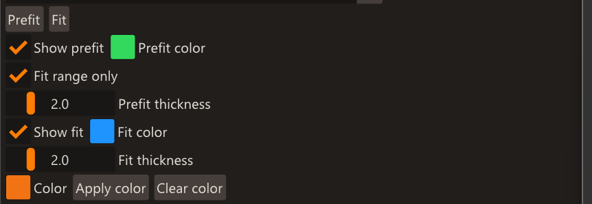
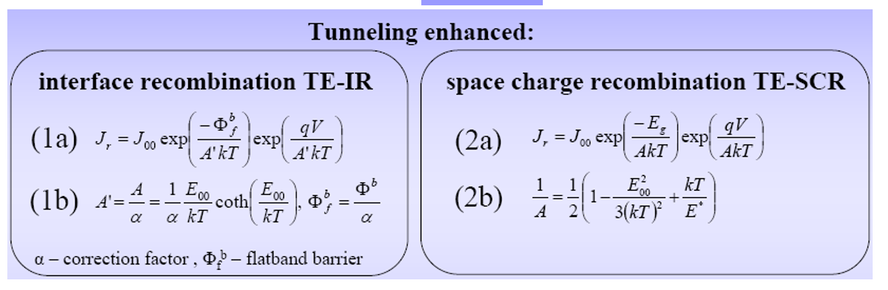
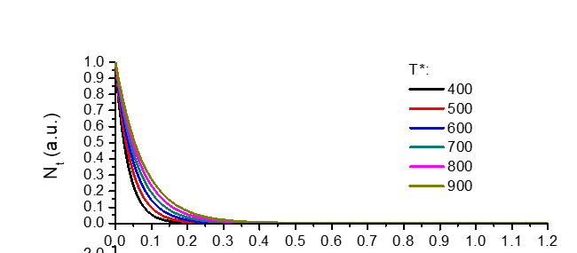

* Characteristic Details, Task Monitor. Settings, Progress Monitor, JFM Ovew

1. Control Panel:

* "show prefit", "show fit" obydwie powinny mieć opcję "show range only"
* najpierw niech będzie opis a dopiero potem kontrolka
* to powinno przyjąc jakąś bardziej ustrukturyzowaną formę, tzn zaczynamy od równej linijki, kolory są pod sobą, checkbox, slider również. Przekształcamy to w profesjonalne UI a nie tak aby tylko na szybko sprawdzić i zrobić tak aby działało
* dodajmy checkbox: auto-prefit-fit (pozwala na zrobienie prefitu i fitu odrazu po zmianie zakresu)
* dodajmy takie same kontrolki: show, color, thicknes: dla Tunned
* obok albo poniżej zakresów Lower Range i Upper Range dodajmy kontrolki pozwalające (slider mantysa + wykładnik) pozwalające kontrolować charakterystykę Tuned
* Dodajmy checkbox dla "fix parameter". Ma to spowodować, że ten parametr nie będzie optymalizowany
* Dodajmy możliwość aby podczas ciągłej zmiany parametrów w tuned, wykonywał się fit z zafiksowanym parametrem obecnie zmienianym (checkbox powinien się sam zaznaczać i odznaczać)
* Jak mamy dla danej charakterystyki zrobioną symulację MC to w tabelce std. error powinna się pojawić niepewność jego wyznaczenia pochodząca z symulacji MC
* dodajmy checkbox aby ukryć z tabelki parametrów te z PreFit
* Możemy usując sekcje MonteCarlo z ControlPanel
* dodajmy kontrolkę (int input) simplex iterations

2. ImportPanel:
* domyślną opcją powinno być "plot after add"
* zlikwidujmy przycisk "prepare data", jak przechodzimy do zakładki "Data rage & prefit" to automatycznie powinny się dane tam pojawiać
* tabelka z parametrami z prefitu, fitu powinna być jedna. W tej samej tabelce powinny być pokazane granice w jakich simplex się porusza (powinna istnieć łatwa możliwość zmiany granic)
* program sam powinien proponować wartości granic dla których simplex nie będzie za bardzo rozrzucony ale też nie powinny być za duże aby fit nie trwał bardzo długo
* usuńmy: "Save N", "Start perturbation" (tego już zdaje sie nie używamy)
* dane które są dodawane do projektu (fit również powinien być dodawany, nie powinienem musieć znowu klikać w ControlPanel przycisku Fit)

3. MC Settings
* Niech ten panel będzie otwarty na start. Nie powinienem musieć za każdym razem go otwierać po przez View
* Każda charakterystyka powinna być "Collapsable Element" ze swoimi osobnymi ustawieniami
* Po przyciśnięciu przycisku "All Selected" lub "Select All" powinno to się przełączać w tryb ustawień dla większej ilości charakterystyk 
* Usuńmy polę "Reduced chi2 taget" -> przenieśmy go do ustawień numerycznych aplikacji
* Niech aplikacja zrobi testowych 100 przebiegów simplex na GPU (dla danej charakterystyki i sprawdzi ile jest maksymalna liczba kroków) dodajmy potem do tej maksymalnej wartości 50 i to ustawmy jako maksymalną ilość kroków. To ustawienie ile kroków i ile testowych symulacji ma być wykonanych powinno być jako ustawienia numeryczne całej aplikacji (SettingsPanel)
* Czym się różni "Fit iterations" od "Simplex iterations"? wydaje mi się, że potrzebujemy tylko jednego
* Seed niech będzie liczbą losową
* Granice zmienności parametrów niech będą tak samo proponowane przez aplikację: moga być przepisane z ControlPanel
* Wyłączmy narazie funkcje rysowania elips i zróbmy domyślne kolory: 1 sigma< #FF1F14FF ; 1-2 sigma #FFE60FFF ; 2-3 sigma #00FFE8FF oraz powinny być w jednym rzędzie z Zoom-out (przed tym sliderem)
* Dla modelu SD-RsRsh domyślne pary parametrów niech będą A-I0, Rs-Rsh
* Dla modelu SD-RsRsh-alpha-Rsh2 domyślne pary parametrów niech będą A-I0, Rs-Rsh, Rsh-Rsh2, alpha-Rsh2
* Guziki: Perform MC on selected, Perform MC on all; Save MC config; Update; Restore;   powinny być na górze MC Settings. Dobrze by było aby miały jednakowy rozmiar i były ładnie ułożone
* Guziki: Add Pair powinien być nad "domyślnymi parami"

4. MC Scatter
* Każdy wykres Scatter powinien być osobnym dockable okienkiem
* selekcja które punkty, kolory powinny być w jednym rzędzie z osiami, auto fit i zoom-out (jeśli obszar jest za mały to powinien być horizontal scroll bar)
* Plot All MC powinno utowrzyć tyle grup ile jest charakterystyk, nazwać je po parach parametrów utowrzyć wykresy dla odpowienich par, i wertykalnie zadokować wykresy MC
* Przycisk "Save" dla każdego wykresu powinien: zapisać plik tsv gdzie będą odpowienio pary punktów i wartość błędu osobno w każdej kolumnie dla każdego z zakresów sigma (chodzi o to aby łatwo było to potem plotować w Origin). Nazwa pliku powinna być taka jak charakterystyki
* Dodajmy przycisk Save Plot: powinien uruchomić (należy napisać taki skrypt pythonowy) który odtworzy taki wykres MC po stronie Matplotlib razem z kolorami, granicami osi, zrobi grid, skalę osi, Tick-in na każdej z osi (dół, lewo, prawo, góra) i zatytułuje wyres odpowienio po nazwie charakterystyki i zapyta gdzie ma to zapisć (NativeFileDialog)
* Przycisk "Save all MC data" powinien robić to samo co przycisk Save (ale dla wszystkich charakterystyk dla których są symulacje MC)
* DDodajmy przycisk Save all MC plots: analogicznie do pojedynczego Save plot: i też wybieramy folder przez NativeFileDialog
 
5. Dodajmy opcję do context menu w project tree aby zapisać dane:
* A(T) [T], 1/A(T)[T] , A*ln(I0) [1000/T], ln(I0) [1000/T], Rs(T) [T], Rsh(T) [T], alpha(T) [T], Rsh2(T) [T]
* waraz z niepewnościami w taki sposób aby to było proste do plotowania w Origin
* To powinno być na poziomie serii, grupy, 
* Oczywiście idzie to przez IOLayer a wybór gdzie przez NativeFileDialog
* nazwa pliku powinna być sugerowana w postaci nazwy serii/grupy
6. Dodajmy opcję aby zapisać charakterystyki i fit w jedyn pliku tsv z całej serii/grupy (nazwa proponowana to nazwa serii/grupy)

6. Arrhenius plots
* Dodajmy okienko gdzie będzie można zrobić następujące wykresy: 
A(T) [T], 1/A(T)[T] , A*ln(I0) [1000/T], ln(I0) [1000/T], Rs(T) [T], Rsh(T) [T], alpha(T) [T], Rsh2(T) [T]

* Ważne jest to, że każda seriia/grupa powinna być jako osobny wykres
*  powinniśmy móc wybrać sobie model do którego się dopasowywujemy
* Dla każdej serii powinna być możliwość zmiany zakresu dopasowania, dodania osobnego dopasowania (tak aby móc porównywać modele)
*  taki wykres też powinien być możliwy
* Dodatkowo powinno być możliwość dopasowania się do zwyczajnego wykresu Arrheniusa i wyznaczenia z tego E_A albo E_g
 